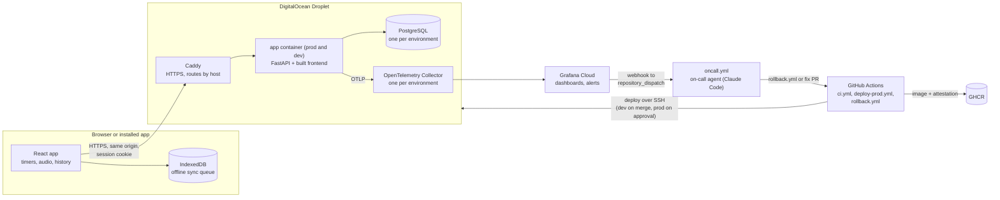

# I Need To Focus

A calm, mobile-friendly focus timer: countdown, Pomodoro and unlimited modes, rain or YouTube in the background, and a history of where your focus time went — by day, week, month, all time or any range, filtered by tag.

Built for the AI Dev Tools Zoomcamp project: one app taken from spec to production with an agent team, CI/CD, observability and an on-call agent. The [grading criteria map](#grading-criteria-map) shows where each criterion is met.

- **Production:** https://ineedtofoc.us
- **Dev:** https://dev.ineedtofoc.us (every merge to `main` deploys here)
- **Task board:** https://github.com/users/ybenzine/projects/2 (backed by this repo's [GitHub Issues](https://github.com/ybenzine/ineedtofocus/issues))
- **Agent instructions:** [AGENTS.md](AGENTS.md), the entry point for every agent, which links the modular docs below
- **Docs:** [product decisions](_docs/product_decisions.md) · [tech stack](_docs/tech_stack.md) · [process](_docs/process.md) · [agent team](_docs/agents.md) · [architecture](_docs/architecture.md) · [testing](_docs/testing.md) · [deployment](_docs/deployment.md) · [observability](_docs/observability.md) · [runbooks](_docs/runbooks/README.md)
- **Grafana screenshots:** [key-journey dashboard and log-to-trace](_docs/observability.md#screenshots), taken on the local stack
- **On-call drills:** [fix drill (#317)](#on-call-drills), where the agent rolled back a broken dev deploy on its own ([incident #319](https://github.com/ybenzine/ineedtofocus/issues/319)), and [alert drill (#35)](#on-call-drills), where it escalated an operator setting
- **Final submission check:** [_docs/submission_check.md](_docs/submission_check.md), the grading-criteria check with commands and evidence (#37)
- **Backlog source:** [_docs/backlog/backlog.yaml](_docs/backlog/backlog.yaml), published to GitHub Issues with [scripts/create_backlog.py](scripts/create_backlog.py)

## The problem

People who want to do focused work, study, read, meditate, exercise or nap need three things that usually live in separate apps: a timer that fits how they work (a fixed countdown, Pomodoro, or open-ended), calm background sound that keeps them in the zone, and an honest record of where their focus time went. I Need To Focus puts all three in one quiet app: start a session in a couple of taps, let it run with rain or a YouTube track in the background, and later review your focus history by day, week, month, all time or any custom range, filtered by what you were focusing on.

The user is one person tracking their own focus time across devices, in a desktop or mobile browser, with the app installable to the home screen. No teams or sharing.

## What it does

The full specification, with every acceptance criterion (`ACx.y`) and the decision log, is [_docs/product_decisions.md](_docs/product_decisions.md). In short:

| Feature | Expected behavior |
|---|---|
| **F1 Accounts** | Sign up and sign in with email and a password of 8 to 128 characters. Sessions and settings live on the server, so a second device shows the same history. Users only ever see their own data |
| **F2 Countdown** | 1 to 240 minutes, counts down to 00:00, then the end bell plays and the session is saved as **Completed**. Pause and resume; stopping early saves it as **Ended early** |
| **F3 Pomodoro** | Defaults 25 min focus, 5 min break, 4 blocks, long break off; all configurable and remembered. Phases advance on their own with a bell; the screen shows the phase and "Block 2 of 4". The whole Pomodoro is one history entry, and only focus time counts |
| **F4 Unlimited** | Counts up until stopped, with an optional gentle chime every 15 to 120 minutes of focus time. Stops itself at 12 hours |
| **F5 Sounds** | A chime and a bell, no voice. Separate volumes for alerts and background audio, with previews |
| **F6 Session rules** | One session at a time. Under 1 minute of focus isn't saved, and the user is told why. An active session survives a reload, and a timer that ends while the app is closed is recorded at its scheduled end |
| **F7 Tags and goal** | Every session has one tag (Work, Study, Nap, Read, Meditation, Exercise; defaults to the last used) and an optional one-line goal of up to 120 characters |
| **F8 Background audio** | None, Rain (a seamless loop that works offline) or a pasted YouTube link in a small visible player. It follows the timer: starts, pauses and stops with it. Bad links show a clear message without affecting the session; the 5 most recent links are remembered |
| **F9 Timer screen** | A dark, distraction-free full-screen view with an optional "Keep screen awake" toggle; works from 360 px wide phones to desktop |
| **F10 History** | Day, Week, Month, All time and Custom range views, filtered by tag: total focus time, session count, time per tag, a bar chart and the session list. Days follow the user's time zone; weeks start on Sunday unless changed |
| **F11 Edit and archive** | Change a session's tag and goal. Archive instead of delete (with Undo); archived sessions can be restored or, after a confirmation that says how many, deleted for good |
| **F12 Settings** | Week start, volumes, keep-awake default and reminder interval, synced across devices |
| **F13 Offline** | Once signed in, the timers, Rain and alerts work without a connection. A finished session is saved on the device first and synced when the connection returns, never duplicated and never lost |

**The rule that matters most:** *a finished session must never be lost.* The key journey is sign in → pick a mode, tag, goal and sound → focus → the session ends → it shows up in History and the totals. That journey is what the tests, the telemetry and the alerts focus on.

**Known limits of a web app:** mobile browsers, iOS especially, may pause sound while the screen is locked. Times stay correct because timers run on start and end timestamps, but chimes and background audio may not play while locked ("Keep screen awake" helps). YouTube needs a visible player and stops in the background on mobile. Out of scope for the MVP: CSV export, streaks, custom tags, manual sessions, notifications, password reset and native apps ([product_decisions.md §6](_docs/product_decisions.md#6-out-of-scope-for-the-mvp-post-mvp-backlog)).

## Architecture



One image holds the API and the built frontend, so the app and the API share an origin and the session cookie stays first-party. The browser keeps finished sessions in IndexedDB and syncs them with client-generated IDs, so a retry never creates a duplicate. Prod and dev are two Compose projects on one Droplet, each with its own app, Postgres and Collector, behind one Caddy. Components, data model and API contract: [_docs/architecture.md](_docs/architecture.md); the OpenAPI document is [_docs/api/openapi.json](_docs/api/openapi.json).

| Layer | Choice |
|---|---|
| Frontend | React + TypeScript (Vite), installable web app (service worker), IndexedDB via Dexie, Web Audio API and the YouTube IFrame Player API |
| Backend | Python 3.12, FastAPI, SQLAlchemy 2 (async), Alembic migrations (backward-compatible only), Uvicorn |
| Database | PostgreSQL 17 |
| Auth | Email + password, argon2 hashing, HTTP-only session cookie |
| Tests | pytest (unit + integration on real Postgres), Vitest + Testing Library, Playwright end to end with axe accessibility checks |
| Containers and hosting | Docker Compose; one DigitalOcean Droplet with Caddy (Let's Encrypt); images in GHCR with build provenance attestations |
| Observability | OpenTelemetry traces and metrics, JSON logs with the trace ID; `grafana/otel-lgtm` locally, Grafana Cloud deployed |
| Agents | Claude Code subagents for the build team; headless Claude Code in GitHub Actions for on-call |

Full stack, hosting, CI/CD and on-call plan: [_docs/tech_stack.md](_docs/tech_stack.md).

## Run it locally

Needs Docker with Compose v2. For tests and linters, also [uv](https://docs.astral.sh/uv/), Node.js ≥ 22 (24 in `frontend/.nvmrc`) and [jq](https://jqlang.org/) (`make test-scripts` uses it).

```sh
cp .env.example .env    # optional: change ports or local credentials
make up                 # build the app image, start everything, wait until healthy
```

`make up` runs `docker compose up -d --build --wait` (`compose.yaml`) and starts:

| Service | What | Where |
|---|---|---|
| `app` | FastAPI API plus the built frontend, one image (`Dockerfile`) | http://localhost:8000 · `GET /healthz` (process), `GET /readyz` (database) |
| `db` | PostgreSQL 17; data in the named volume `db-data` | `localhost:5432`, user/password/db `focus` |
| `lgtm` | Grafana with Tempo, Prometheus and Loki (`grafana/otel-lgtm`) | http://localhost:3000 (no login) · OTLP on 4317/4318 |

- **Start order:** the app container starts only once Postgres passes its health check (`pg_isready`). It first applies the database migrations (`alembic upgrade head`), then starts the server, and Compose marks it healthy when `GET /healthz` answers. If a migration fails, the server doesn't start and `make up` fails: see `docker compose logs app`. Setting `MIGRATE_ON_START=0` in `.env` skips the step (see [deployment.md](_docs/deployment.md#app-image-and-migrations)).
- **Data:** `make down` stops the stack and keeps the database. To wipe it, run `docker compose down -v`, which deletes the volume.
- **Telemetry:** the app runs under `opentelemetry-instrument` and sends traces (one per request, except `/healthz`), HTTP metrics and its JSON logs over OTLP to `lgtm`. In Grafana, open **Explore** and pick **Tempo**, **Prometheus** or **Loki**, filtering on service `ineedtofocus`. Query strings and cookies are stripped from traces. Logs sent to Grafana get the same scrubbing as stdout, which includes Postgres `DETAIL` lines with row values.
- **Check it:** `make check-stack` probes the health endpoints and the frontend, and signs up a throwaway account to check that sign-in works over plain http (the session cookie must not be `Secure` locally). It then waits until Grafana has traces, metrics and logs from the app, and fails if a query string or cookie reached telemetry. Each run leaves its account, a `stack-check-<hex>@example.com` user with a random password, in the local database. That's harmless: nobody can sign in as it, and `docker compose down -v` clears it with the rest of the data.
- **App settings:** `compose.yaml` passes the app settings from `.env` (log level, `SESSION_TTL_DAYS`, the `SIGNIN_*` and `SIGNUP_*` rate limits) to the app container, with the app's own defaults when unset. Edit `.env`, then run `make up` again.
- **Ports taken?** Set `APP_PORT`, `POSTGRES_PORT`, `GRAFANA_PORT`, `OTLP_GRPC_PORT` or `OTLP_HTTP_PORT` in `.env`.
- **Other commands:** `make logs` (follow all logs), `make test`, `make lint`, `make help`. The backend integration tests use the `db` from `make up`.

For backend work with hot reload, run only the database with `docker compose up -d db`, then follow [backend/README.md](backend/README.md).

## Test

```sh
make up      # the integration and end-to-end tests use the running stack
make test    # every suite: backend unit + integration, frontend unit, repo scripts, server and infra checks, Playwright
make lint    # ruff, mypy, ESLint, Prettier, tsc, shellcheck, actionlint
```

- **Backend:** pytest unit tests (`backend/tests/unit/`) and integration tests against a real Postgres (`backend/tests/integration/`), which create a throwaway database for each run.
- **Frontend:** Vitest + Testing Library next to the code (`frontend/src/**/*.test.ts(x)`), with a fake clock for the timer engine.
- **End to end:** Playwright (`frontend/e2e/`) drives the key journey through the real Compose stack (sign up, timers, offline finish then sync, a second device, history, archive), plus axe accessibility checks on every main screen. A default local stack allows 10 sign-ups an hour, so start it with `SIGNUP_MAX_PER_CLIENT=1000` before running them.

CI ([`.github/workflows/ci.yml`](.github/workflows/ci.yml)) runs the same targets on every pull request and push to `main`, and five of its jobs are required checks for merging. Layers, commands and rules: [_docs/testing.md](_docs/testing.md).

## Deploy and roll back

| Step | How | Details |
|---|---|---|
| **Dev** | Automatic on every merge to `main`: CI builds one image tagged with the commit SHA, pushes it to GHCR with a provenance attestation, deploys it to the Droplet over SSH and smoke-tests https://dev.ineedtofoc.us | [Deploy to dev](_docs/deployment.md#deploy-to-dev-28) |
| **Prod** | Manual: **Actions** → **deploy-prod** → **Run workflow** ([`deploy-prod.yml`](.github/workflows/deploy-prod.yml)). It takes the image dev runs by default, waits for Yacine's approval in the `production` environment, and verifies the image's attestation before deploying | [Deploy to prod](_docs/deployment.md#deploy-to-prod-29) |
| **Automatic revert** | Every deploy runs migrations, restarts the app and checks `/healthz` and `/readyz`; if a check fails, it redeploys the previous release | [Health checks and automatic revert](_docs/deployment.md#health-checks-and-automatic-revert-30) |
| **Rollback** | `gh workflow run rollback.yml -f env=prod` (or `env=dev`, optionally `-f tag=<sha>`) restores the last known-good release. No approval needed, so the on-call agent can run it | [Rollback](_docs/deployment.md#rollback-rollbackyml), [runbook](_docs/runbooks/rollback.md) |

Migrations only ever add, so rolling the app back never needs a database downgrade. The rollback was [demonstrated on dev](_docs/deployment.md#demonstration) with a deliberately broken build ([#167](https://github.com/ybenzine/ineedtofocus/pull/167), [rollback run](https://github.com/ybenzine/ineedtofocus/actions/runs/40160362879), [revert #168](https://github.com/ybenzine/ineedtofocus/pull/168)). Server setup and credentials: [_docs/deployment.md](_docs/deployment.md) and [infra/README.md](infra/README.md).

## Observability and on-call

- **Signals:** the key journey (saving a finished session, including offline sync batches, and loading history) has traces, metrics (saves and history loads by outcome, with latency) and JSON logs. They all carry the same trace ID, so Grafana jumps from a log line to its trace and from a latency point to the request behind it. Emails, passwords, cookies, goals and YouTube links never reach telemetry: allowlists enforce it and tests cover it.
- **Dashboards:** one key-journey dashboard per environment ([infra/grafana/dashboards/](infra/grafana/dashboards/)); [screenshots](_docs/observability.md#screenshots).
- **Alerts on user impact, not CPU:** **Session saves failing** (over 5% of saves fail in 5 minutes, with at least 10 sessions) and **History slow** (p95 above 2 s over 5 minutes, with at least 5 loads), per environment ([infra/grafana/alerts/](infra/grafana/alerts/)). A fault-injection setting only the operator can change (`FAULT_SAVE_ERROR_PERCENT`, off by default) and [scripts/traffic.py](scripts/traffic.py) make the save alert fire on demand.
- **On-call agent:** Grafana's webhook calls GitHub's `repository_dispatch`, which starts [`.github/workflows/oncall.yml`](.github/workflows/oncall.yml). Headless Claude Code ([`.claude/agents/oncall.md`](.claude/agents/oncall.md)) opens or updates an incident issue, reads metrics, traces and logs through a read-only Grafana token and follows the [runbooks](_docs/runbooks/README.md). If a recent deploy caused it, it rolls back; if the code is at fault, it opens a fix PR with a regression test that the reviewer must approve; otherwise it escalates. It then waits for the alert to resolve and posts an incident summary. It can't push to `main`; its only way to change prod is a rollback to a known-good release.

Details: [_docs/observability.md](_docs/observability.md).

### On-call drills

- **On-call fix drill ([#317](https://github.com/ybenzine/ineedtofocus/issues/317)), dev, 2026-10-26:** a deliberately broken build ([PR #318](https://github.com/ybenzine/ineedtofocus/pull/318): every save returned 500 on dev only) reached dev through the normal CI deploy. **Session saves failing (dev)** fired at 14:49:30 UTC with 100% of saves failing. The [on-call run](https://github.com/ybenzine/ineedtofocus/actions/runs/40343299665) opened [incident #319](https://github.com/ybenzine/ineedtofocus/issues/319), tied the failures to that deploy through the traces' service version, decided `rollback`, and the workflow ran the [rollback](https://github.com/ybenzine/ineedtofocus/actions/runs/40343637237) itself (started by `github-actions[bot]`, no human), restoring dev to `d6bc665`. Saves failed for about 6 minutes, and the alert resolved at 14:57:30 UTC ([resolved run](https://github.com/ybenzine/ineedtofocus/actions/runs/40344593714)). The workflow's daily run cap had been reached, so it wrote the closing summary itself, without an agent session ([#312](https://github.com/ybenzine/ineedtofocus/issues/312)). [Revert PR #321](https://github.com/ybenzine/ineedtofocus/pull/321) took the demo off `main`; prod never ran the broken build. Write-up: [observability.md](_docs/observability.md#on-call-drill-rollback-of-a-bad-deploy-317); [evidence comment on #317](https://github.com/ybenzine/ineedtofocus/issues/317#issuecomment-6420041438).
- **Alert drill (#35), dev, 2026-10-26:** 30% of saves made to fail, traffic script run, **Session saves failing (dev)** fired, the [on-call run](https://github.com/ybenzine/ineedtofocus/actions/runs/40276987971) woke up on [incident #231](https://github.com/ybenzine/ineedtofocus/issues/231), found the injected fault in the traces and escalated with the exact ask to turn it off (an operator setting, so neither a rollback nor a fix applies). Once it was off the alert resolved ([resolved run](https://github.com/ybenzine/ineedtofocus/actions/runs/40278298276)). Timeline and verdict per expected outcome: [issue #35](https://github.com/ybenzine/ineedtofocus/issues/35#issuecomment-6409695167).

## How it was built

A team of Claude Code subagents built the app from the issues on the board: product manager, backend, frontend, QA, DevOps and reviewer, plus the on-call agent ([_docs/agents.md](_docs/agents.md), definitions in [.claude/agents/](.claude/agents/)). Each issue carries testable acceptance criteria. Its agent posts a start comment, works on its own branch and opens a PR that says `Closes #<n>`. The reviewer agent approves or requests changes, CI must be green to merge, QA verifies features, and the product manager gives final acceptance with the `accepted` label ([_docs/process.md](_docs/process.md)). `/work-issue <n>` and `/work-backlog` ([.claude/commands/](.claude/commands/)) run that loop. Yacine, the product owner, steps in only at the [human gates](_docs/process.md#human-gates): production deploys, accounts and secrets, scope, cost and irreversible actions. Example trail: [issue #10](https://github.com/ybenzine/ineedtofocus/issues/10) (sessions API) → [PR #87](https://github.com/ybenzine/ineedtofocus/pull/87), with the backend agent's start, PR and done comments, the product manager's rulings, QA's verification and the acceptance.

## Grading criteria map

The 12 criteria of the [AI Dev Tools Zoomcamp project](https://github.com/DataTalksClub/ai-dev-tools-zoomcamp/blob/main/project/README.md#criteria):

| Criterion | Where it's met |
|---|---|
| **Problem description** | This README: [The problem](#the-problem) and [What it does](#what-it-does), from [_docs/product_decisions.md](_docs/product_decisions.md) |
| **Product specification** | Spec: [_docs/product_decisions.md](_docs/product_decisions.md) (`F1`–`F13`, `ACx.y`, decision log). Public tracker: [task board](https://github.com/users/ybenzine/projects/2) and [issues](https://github.com/ybenzine/ineedtofocus/issues), each with acceptance criteria as checkboxes, published from [_docs/backlog/backlog.yaml](_docs/backlog/backlog.yaml). Agents' use of it: e.g. [#10](https://github.com/ybenzine/ineedtofocus/issues/10) → [PR #87](https://github.com/ybenzine/ineedtofocus/pull/87) |
| **Agent team specification** | [_docs/agents.md](_docs/agents.md) (roles, hand-offs, orchestration), [_docs/process.md](_docs/process.md) (issue → PR → review → merge → acceptance, human gates), [.claude/agents/](.claude/agents/), [.claude/commands/](.claude/commands/) |
| **Context management** | [AGENTS.md](AGENTS.md) (with [CLAUDE.md](CLAUDE.md) pointing at it) describes the project and links the modular docs in [_docs/](_docs/) |
| **Application** | React frontend ([frontend/](frontend/)), FastAPI backend ([backend/](backend/)), PostgreSQL; the whole stack starts with `make up` ([compose.yaml](compose.yaml)). [frontend/e2e/journey.spec.ts](frontend/e2e/journey.spec.ts) proves the frontend → API → database path |
| **Testing** | Unit ([backend/tests/unit/](backend/tests/unit/), `frontend/src/**/*.test.ts(x)`), integration ([backend/tests/integration/](backend/tests/integration/)) and end-to-end ([frontend/e2e/](frontend/e2e/)) tests, all run by `make test` ([_docs/testing.md](_docs/testing.md)); green on `main` in [CI run 40323685784](https://github.com/ybenzine/ineedtofocus/actions/runs/40323685784) |
| **Containerization** | [Dockerfile](Dockerfile) (one app image) and [compose.yaml](compose.yaml) (app, Postgres, Grafana), started with `make up`; production: [infra/compose.prod.yml](infra/compose.prod.yml), [infra/compose.edge.yml](infra/compose.edge.yml) |
| **Deployment** | Live at https://ineedtofoc.us (prod) and https://dev.ineedtofoc.us (dev) on a DigitalOcean Droplet ([_docs/deployment.md](_docs/deployment.md)) |
| **CI/CD** | CI on every PR and CD to dev on merge: [ci.yml](.github/workflows/ci.yml) ([run 40323685784](https://github.com/ybenzine/ineedtofocus/actions/runs/40323685784): tests, publish, `Deploy to dev`). Manual prod deploy approved by Yacine: [deploy-prod.yml](.github/workflows/deploy-prod.yml) ([run 40327763725](https://github.com/ybenzine/ineedtofocus/actions/runs/40327763725)). Rollback: [rollback.yml](.github/workflows/rollback.yml) ([run 40160362879](https://github.com/ybenzine/ineedtofocus/actions/runs/40160362879)) |
| **Observability** | [_docs/observability.md](_docs/observability.md): traces, metrics and logs sharing a trace ID on the key journey (`backend/app/telemetry.py`, `metrics.py`, `logging_config.py`); privacy tests (`backend/tests/unit/test_telemetry.py`, `test_logging_fields.py`, `backend/tests/integration/test_journey_telemetry.py`); viewable in Grafana: [dashboards](infra/grafana/dashboards/), [screenshots](_docs/observability.md#screenshots) |
| **Alerting on user impact** | Save-error and history-latency rules in [infra/grafana/alerts/](infra/grafana/alerts/), checked by [scripts/tests/test_grafana_alerts.py](scripts/tests/test_grafana_alerts.py); alert trigger: fault injection ([backend/app/faults.py](backend/app/faults.py)) and [scripts/traffic.py](scripts/traffic.py) ([_docs/observability.md](_docs/observability.md#alerts-user-impact-not-resources)) |
| **On-call agent** | [oncall.yml](.github/workflows/oncall.yml), [.claude/agents/oncall.md](.claude/agents/oncall.md), [runbooks](_docs/runbooks/README.md). Fix drill [#317](https://github.com/ybenzine/ineedtofocus/issues/317): a real alert on a broken dev deploy woke the agent, which rolled dev back on its own ([incident #319](https://github.com/ybenzine/ineedtofocus/issues/319); [write-up](_docs/observability.md#on-call-drill-rollback-of-a-bad-deploy-317); [evidence](https://github.com/ybenzine/ineedtofocus/issues/317#issuecomment-6420041438); [alert run](https://github.com/ybenzine/ineedtofocus/actions/runs/40343299665), [rollback run](https://github.com/ybenzine/ineedtofocus/actions/runs/40343637237), [resolved run](https://github.com/ybenzine/ineedtofocus/actions/runs/40344593714)). Escalation drill [#35](https://github.com/ybenzine/ineedtofocus/issues/35#issuecomment-6409695167) ([incident #231](https://github.com/ybenzine/ineedtofocus/issues/231)) |
