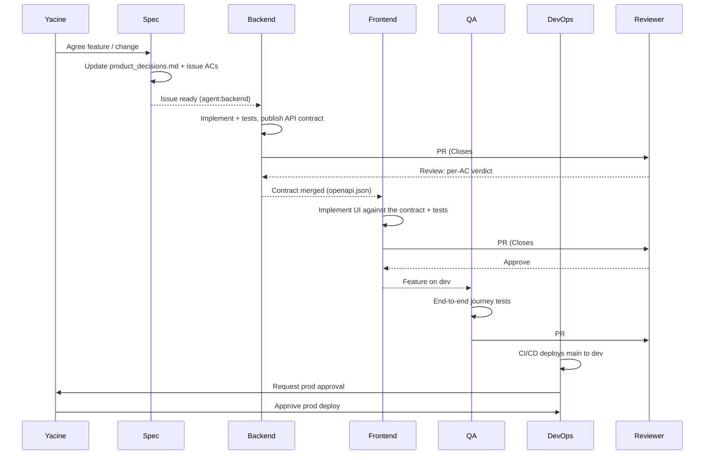

# Agent team

Seven agents build and run I Need To Focus. Six are Claude Code subagents that build the app; the seventh, the on-call agent, runs headless in GitHub Actions and responds to production alerts. Yacine is the product owner and the only human on the team.

Ownership is visible on the board: every issue carries the `agent:*` label of the agent that owns it.

## Roles

| Agent | Label | Owns | Reads first | Produces | Does not |
|---|---|---|---|---|---|
| **Spec** | `agent:spec` | Requirements, acceptance criteria, docs, README, the backlog | product_decisions, tech_stack, process | Updated `product_decisions.md`, issues with ACs, `_docs/*`, README | Write application code |
| **Backend** | `agent:backend` | FastAPI app, data model, migrations, API contract, backend instrumentation | product_decisions, architecture, testing, observability | `backend/` code + pytest unit/integration tests, `_docs/api/openapi.json` | Change frontend code or infra |
| **Frontend** | `agent:frontend` | React app: timers, audio, offline sync, history, settings, installable app | product_decisions, architecture, testing | `frontend/` code + Vitest tests, Playwright tests for its screens | Change the API contract unilaterally |
| **QA** | `agent:qa` | Cross-cutting test strategy, end-to-end journeys, accessibility, final submission check | product_decisions, testing | Playwright suites, test fixtures, bug issues with repro steps | Fix product code (files a bug issue instead) |
| **DevOps** | `agent:devops` | Docker/Compose, CI/CD, Droplet, Caddy, deploy and rollback, Grafana wiring and alerts | tech_stack, deployment, observability | `infra/`, `.github/workflows/`, `Makefile`, deploy scripts | Deploy to prod without Yacine's approval |
| **Reviewer** | — (reviews every PR) | Quality gate: ACs, definition of done, conventions, security and telemetry privacy | the PR's issue, product_decisions, process | A PR review with a per-AC table and a `Verdict:` line | Edit, commit, push or merge; review work it wrote |
| **On-call** | `agent:oncall` | Responding to production alerts | runbooks, AGENTS.md, process, observability, deployment | Incident issue, rollback run or fix PR (`oncall/<n>-<slug>`), incident summary | Push to `main`; merge; deploy anything except a known-good tag |

**Yacine (product owner):** agrees scope changes, does `owner:human` tasks (DigitalOcean, Route 53, Grafana Cloud, secrets), approves production deploys, and merges workflow, production-infra, prod-deploy and incident-fix PRs himself.

## How a piece of work flows through the team

## Hand-offs

| From → To | What is handed over | Where |
|---|---|---|
| Spec → everyone | Acceptance criteria for each issue | Issue body; `product_decisions.md` |
| Backend → Frontend | The API contract: endpoints, request/response schemas, error format | `_docs/api/openapi.json` (exported from FastAPI in the backend PR); frontend generates its TypeScript client types from it |
| Backend/Frontend → QA | A feature merged and running on dev, with the ACs it covers | Closing comment on the issue |
| QA → Backend/Frontend | Bugs found by end-to-end or accessibility tests | New issue labeled with the owner's `agent:*`, linked to the original |
| DevOps → Backend/Frontend | How to run, test and configure the app (env vars, compose services) | `Makefile`, `.env.example`, `deployment.md` |
| Backend/DevOps → On-call | Signals, dashboards, alert rules, runbooks | `observability.md`, `runbooks/` |
| On-call → Backend/Frontend | Regression found in production that a rollback didn't settle | Incident issue + fix PR or follow-up issue |
| Anyone → Spec | A missing, wrong or ambiguous acceptance criterion | Comment on the issue mentioning the spec agent; spec updates the doc and the issue |
| Anyone → Yacine | A step only a human can do | `⛔ Needs Yacine:` comment with exact instructions |

**Contract-first rule:** when a frontend issue depends on an endpoint, the backend PR that defines it merges first. If the frontend must start earlier, the backend agent posts the planned schema on the frontend issue and both build against that.

## Subagent definitions

Each agent is a Claude Code subagent: a role prompt, the tools it may use, and the docs it must read before working.

| Agent | Definition | Tools |
|---|---|---|
| Spec | [`.claude/agents/spec.md`](../.claude/agents/spec.md) | Read, Write, Edit, Glob, Grep, Bash, WebSearch, WebFetch |
| Backend | [`.claude/agents/backend.md`](../.claude/agents/backend.md) | Read, Write, Edit, Glob, Grep, Bash |
| Frontend | [`.claude/agents/frontend.md`](../.claude/agents/frontend.md) | Read, Write, Edit, Glob, Grep, Bash |
| QA | [`.claude/agents/qa.md`](../.claude/agents/qa.md) | Read, Write, Edit, Glob, Grep, Bash |
| DevOps | [`.claude/agents/devops.md`](../.claude/agents/devops.md) | Read, Write, Edit, Glob, Grep, Bash |
| Reviewer | [`.claude/agents/reviewer.md`](../.claude/agents/reviewer.md) | Read, Glob, Grep, Bash — no Write/Edit tools; Bash is for running tests and `gh`, and its role forbids editing, committing, pushing or merging |
| On-call | [`.claude/agents/oncall.md`](../.claude/agents/oncall.md) | Read, Write, Edit, Glob, Grep, Bash — run headless by the alert workflow (#35) |

## Orchestration

A main Claude Code session acts as the **lead**. The `/work-issue <n>` command ([`.claude/commands/work-issue.md`](../.claude/commands/work-issue.md)) runs the loop for one issue:

1. Read the issue; check its dependencies and whether it needs Yacine (`owner:human`).
2. Delegate it to the subagent named by its `agent:*` label.
3. That subagent posts the start comment, moves the card, branches, implements, tests, opens the PR, posts the PR-open comment, and stops.
4. The lead runs the **reviewer** subagent on the PR; on `Verdict: Request changes` the findings go back to the author, until `Verdict: Approve`.
5. Workflow, production-infra, prod-deploy and incident-fix PRs: Yacine merges. Otherwise the lead re-invokes the author to squash-merge, tick the issue's checkboxes and post the done comment.
6. For `type:feature` issues, the lead invokes **QA** to verify the feature on dev.

Independent issues (e.g. a backend API and an unrelated DevOps task) can run in parallel; dependent ones run in order.

## Tracker trail

Every step leaves a trace on the issue and the board, so the board is the record of what each agent did:

| Step | Trace | How |
|---|---|---|
| Start | `🟡 <agent> agent — started` comment; card → In progress | `gh issue comment`; `scripts/board-status.sh <n> "In progress"` |
| PR opened | `🔵 <agent> agent — PR open: #<pr>` comment; card → In review | `gh pr create`; `scripts/board-status.sh <n> "In review"` |
| Review | PR review with a per-AC table ending in `Verdict: Approve` / `Verdict: Request changes` | `gh pr review --comment` (reviewer subagent) |
| Verified | `🧪 qa agent — verified on dev` comment, or a `bug` issue | `gh issue comment` / `gh issue create` (QA subagent) |
| Done | Issue checkboxes ticked; `✅ <agent> agent — done` comment; card → Done | `gh issue edit`; board workflow on close |
| Blocked | `⛔ Blocked by #<n>` / `⛔ Needs Yacine:` comment | `gh issue comment` |

Board workflows (project settings) also move cards automatically: added → Todo, closed or merged → Done. The script needs a `gh` token with the `project` scope: `gh auth refresh -s project`.
