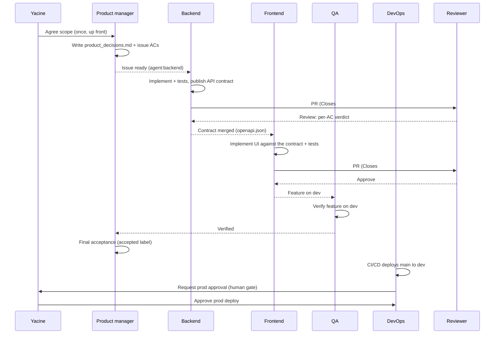

# Agent team

Seven agents build and run I Need To Focus. Six are Claude Code subagents that build the app; the seventh, the on-call agent, runs headless in GitHub Actions and responds to production alerts. Yacine is the product owner and the only human on the team.

Ownership is visible on the board: every issue carries the `agent:*` label of the agent that owns it.

## Roles

| Agent | Label | Owns | Reads first | Produces | Does not |
|---|---|---|---|---|---|
| **Product manager** | `agent:product_manager` | Requirements, acceptance criteria, product decisions within agreed scope (decision log), docs, README, the backlog, **final acceptance** | product_decisions, tech_stack, process | Updated `product_decisions.md`, issues with ACs, `_docs/*`, README, `accepted` label | Write application code; change agreed scope without Yacine |
| **Backend** | `agent:backend` | FastAPI app, data model, migrations, API contract, backend instrumentation | product_decisions, architecture, testing, observability | `backend/` code + pytest unit/integration tests, `_docs/api/openapi.json` | Change frontend code or infra |
| **Frontend** | `agent:frontend` | React app: timers, audio, offline sync, history, settings, installable app | product_decisions, architecture, testing | `frontend/` code + Vitest tests, Playwright tests for its screens | Change the API contract unilaterally |
| **QA** | `agent:qa` | Cross-cutting test strategy, end-to-end journeys, accessibility, final submission check | product_decisions, testing | Playwright suites, test fixtures, bug issues with repro steps | Fix product code (files a bug issue instead) |
| **DevOps** | `agent:devops` | Docker/Compose, CI/CD, Droplet, Caddy, deploy and rollback, Grafana wiring and alerts | tech_stack, deployment, observability | `infra/`, `.github/workflows/`, `Makefile`, deploy scripts | Deploy to prod without Yacine's approval |
| **Reviewer** | — (reviews every PR) | Quality gate: ACs, definition of done, conventions, security and telemetry privacy | the PR's issue, product_decisions, process | A PR review with a per-AC table and a `Verdict:` line | Edit, commit, push or merge; review work it wrote |
| **On-call** | `agent:oncall` | Responding to production alerts | runbooks, AGENTS.md, process, observability, deployment | Incident issue, rollback run or fix PR (`oncall/<n>-<slug>`), incident summary | Push to `main`; merge before the reviewer's Approve; deploy to prod except a rollback to a known-good tag |

**Yacine (product owner):** involved only at the [human gates](process.md#human-gates): approves production deploys, does `owner:human` tasks (DigitalOcean, Route 53, Grafana Cloud, secrets), decides questions beyond agreed scope, cost or irreversible actions, and steps in when a PR fails review three times or CI can't be made green.

## How a piece of work flows through the team

## Hand-offs

| From → To | What is handed over | Where |
|---|---|---|
| Product manager → everyone | Acceptance criteria for each issue; decisions on ambiguities | Issue body; `product_decisions.md` (incl. decision log) |
| Backend → Frontend | The API contract: endpoints, request/response schemas, error format | `_docs/api/openapi.json` (exported from FastAPI in the backend PR); frontend generates its TypeScript client types from it |
| Backend/Frontend → QA | A feature merged and running on dev, with the ACs it covers | Closing comment on the issue |
| QA → Backend/Frontend | Bugs found by end-to-end or accessibility tests | New issue labeled with the owner's `agent:*`, linked to the original |
| DevOps → Backend/Frontend | How to run, test and configure the app (env vars, compose services) | `Makefile`, `.env.example`, `deployment.md` |
| Backend/DevOps → On-call | Signals, dashboards, alert rules, runbooks | `observability.md`, `runbooks/` |
| On-call → Backend/Frontend | Regression found in production that a rollback didn't settle | Incident issue + fix PR or follow-up issue |
| Anyone → Product manager | A missing, wrong or ambiguous acceptance criterion | Comment on the issue; the product manager decides (within scope) or escalates, and updates the doc and the issue |
| QA → Product manager | Feature verified on dev | `🧪 verified` comment; then the product manager runs final acceptance (for the product manager's own issues, QA gives the acceptance instead) |
| Anyone → Yacine | A human gate (see process.md) | `⛔ Needs Yacine:` comment with exact instructions + `needs-yacine` label; Yacine answers and removes the label |

**Contract-first rule:** when a frontend issue depends on an endpoint, the backend PR that defines it merges first. If the frontend must start earlier, the backend agent posts the planned schema on the frontend issue and both build against that.

## Subagent definitions

Each agent is a Claude Code subagent: a role prompt, the tools it may use, and the docs it must read before working.

| Agent | Definition | Tools |
|---|---|---|
| Product manager | [`.claude/agents/product-manager.md`](../.claude/agents/product-manager.md) | Read, Write, Edit, Glob, Grep, Bash, WebSearch, WebFetch |
| Backend | [`.claude/agents/backend.md`](../.claude/agents/backend.md) | Read, Write, Edit, Glob, Grep, Bash |
| Frontend | [`.claude/agents/frontend.md`](../.claude/agents/frontend.md) | Read, Write, Edit, Glob, Grep, Bash |
| QA | [`.claude/agents/qa.md`](../.claude/agents/qa.md) | Read, Write, Edit, Glob, Grep, Bash |
| DevOps | [`.claude/agents/devops.md`](../.claude/agents/devops.md) | Read, Write, Edit, Glob, Grep, Bash |
| Reviewer | [`.claude/agents/reviewer.md`](../.claude/agents/reviewer.md) | Read, Glob, Grep, Bash — no Write/Edit tools; Bash is for running tests and `gh`, and its role forbids editing, committing, pushing or merging |
| On-call | [`.claude/agents/oncall.md`](../.claude/agents/oncall.md) | Read, Write, Edit, Glob, Grep, Bash — run headless by the alert workflow (#35) |

## Models

Each agent's model and effort level are set in its `.claude/agents/*.md` frontmatter. Opus 5.5 goes where judgment matters and volume is low; Sonnet 5.5 goes where most of the code is written (half Opus's price and faster, with the Opus reviewer as backstop). Decided with Yacine on 2026-10-21 (#54).

| Agent | Model | Effort | Why |
|---|---|---|---|
| Lead (main session) | Opus 5.5 | medium | Hours of orchestration — dependencies, gates, when to stop; mistakes compound |
| Product manager | Opus 5.5 | medium | Scope decisions and final acceptance are judgment calls; low output volume |
| Reviewer | Opus 5.5 | high | The quality gate; a weaker reviewer costs more in rework than it saves |
| DevOps | Opus 5.5 | high | Few issues, high stakes: credentials, deploys, rollback, the server |
| On-call | Opus 5.5 | high | Runs rarely; the rollback-or-fix decision has to be right |
| Backend | Sonnet 5.5 | default (high) | Bulk of the code; fast and cheaper |
| Frontend | Sonnet 5.5 | default (high) | Largest share of issues |
| QA | Sonnet 5.5 | default (high) | Well-specified test writing and running |

- **Lead session:** start Claude Code with `/model opus` and `/effort medium` before `/work-backlog`. Subagents use the `model:` and `effort:` in their frontmatter unless the lead passes a per-invocation model override, which takes precedence.
- **Opus overrides:** `/work-issue` runs **#11** (history grouping by time zone and week start), **#13** (timer engine) and **#19** (offline sync without duplicates) on Opus — the trickiest logic in the app — without changing the agents' defaults. These runs use Opus's default effort.
- **Fable 5.1 retry:** after three failed review rounds, the author gets one retry on Fable 5.1 before the repeated-failure gate. Not used otherwise (2.5× Opus's price, slower).
- **Haiku 5.5:** not assigned; no agent does simple, high-volume work.
- **Subscription limits:** Yacine runs Claude Code on a subscription, where Opus uses limits faster. If a run hits limits, move the lead to Sonnet first (`/model sonnet`); keep the reviewer on Opus.
- **Keep these unset:** `CLAUDE_CODE_SUBAGENT_MODEL_FORCE` (makes Claude Code ignore the `model:` field) and `CLAUDE_CODE_EFFORT_LEVEL` (overrides every agent's `effort:`).

## Orchestration

A main Claude Code session acts as the **lead**. The `/work-issue <n>` command ([`.claude/commands/work-issue.md`](../.claude/commands/work-issue.md)) runs the loop for one issue:

1. Read the issue; check its dependencies and whether it needs Yacine (`owner:human`).
2. Delegate it to the subagent named by its `agent:*` label.
3. That subagent posts the start comment, moves the card, branches, implements, tests, opens the PR, posts the PR-open comment, and stops.
4. The lead runs the **reviewer** subagent on the PR; on `Verdict: Request changes` the findings go back to the author, until `Verdict: Approve`. After three rounds without Approve the author gets one retry on Fable 5.1 (see [Models](#models)); if that fails too, it's the repeated-failure [human gate](process.md#human-gates).
5. With CI green, the lead re-invokes the author to squash-merge, tick the issue's checkboxes and post the done comment.
6. For `type:feature` issues, the lead invokes **QA** to verify the feature on dev.
7. The lead invokes the **product manager** for final acceptance (or **QA** for the product manager's own issues): `accepted` label, or the issue is reopened with gaps.

`/work-backlog [milestone]` ([`.claude/commands/work-backlog.md`](../.claude/commands/work-backlog.md)) runs this loop over every open issue in milestone and priority order. When an issue hits a [human gate](process.md#human-gates), the lead posts the ask and moves on to the next runnable issue, so the team only stops when nothing runnable is left.

Independent issues (e.g. a backend API and an unrelated DevOps task) can run in parallel; dependent ones run in order.

**At most 4 agents run at once per session** (#172). On 2026-10-23 eight or more agents running in parallel kept tripping GitHub's secondary GraphQL rate limit and blocked board moves. The `env` block in [`.claude/settings.json`](../.claude/settings.json) enforces the cap in Claude Code itself:

- `CLAUDE_CODE_MAX_CONCURRENT_SUBAGENTS=4`: with 4 subagents running, spawning another with the Agent tool fails with `Concurrent subagent limit reached`. The spawn is refused, not queued. When that happens the lead **waits for a running agent to finish** and spawns then; it doesn't retry in a loop.
- `CLAUDE_CODE_WORKFLOW_MAX_CONCURRENT_AGENTS=4`: a [workflow](https://code.claude.com/docs/en/workflows) run executes at most 4 agents at once and queues the rest. This cap is per workflow run, not per session, and the Claude Code docs say workflow agents follow their own limit rather than the subagent one.
- The cap is per session: two sessions in parallel (e.g. one per milestone worktree) mean at most 8 agents in total.
- A session reads the variables when it starts, so a session started before the change must be restarted to pick them up.

Documented exceptions ([Claude Code docs → Concurrent subagent limit](https://code.claude.com/docs/en/sub-agents#concurrent-subagent-limit)): resuming a subagent that already finished takes a fresh slot without checking the limit, and a `/subtask` fork takes a slot and is never blocked, so both can push the count past 4. Sessions with ultracode on don't enforce the limit at all, so don't turn ultracode on (`/effort ultracode`, `claude --effort ultracode` or the `ultracode` setting).

## Tracker trail

Every step leaves a trace on the issue and the board, so the board is the record of what each agent did:

| Step | Trace | How |
|---|---|---|
| Start | `🟡 <agent> agent — started` comment; card → In progress | `gh issue comment`; `scripts/board-status.sh <n> "In progress"` |
| PR opened | `🔵 <agent> agent — PR open: #<pr>` comment; card → In review | `gh pr create`; `scripts/board-status.sh <n> "In review"` |
| Review | PR review from the reviewer App's bot (approve or request changes) with a per-AC table ending in `Verdict: Approve` / `Verdict: Request changes` | `scripts/reviewer-review.sh` → `gh pr review --approve` / `--request-changes` (reviewer subagent) |
| Verified | `🧪 qa agent — verified on dev` comment, or a `bug` issue | `gh issue comment` / `gh issue create` (QA subagent) |
| Accepted | `accepted` label + `🟢 product manager agent — accepted` comment, or issue reopened with `🔴 not accepted` (QA posts the acceptance on the product manager's own issues) | `gh issue edit --add-label accepted` (product manager subagent; QA subagent for the product manager's own issues) |
| Done | Issue checkboxes ticked; `✅ <agent> agent — done` comment; card → Done | `gh issue edit`; board workflow on close |
| Blocked | `⛔ Blocked by #<n>` comment, or `⛔ Needs Yacine:` comment + `needs-yacine` label | `gh issue comment`; `gh issue edit --add-label needs-yacine` |

Board workflows (project settings) also move cards automatically: added → Todo, closed or merged → Done. The script needs a `gh` token with the `project` scope: `gh auth refresh -s project`.
