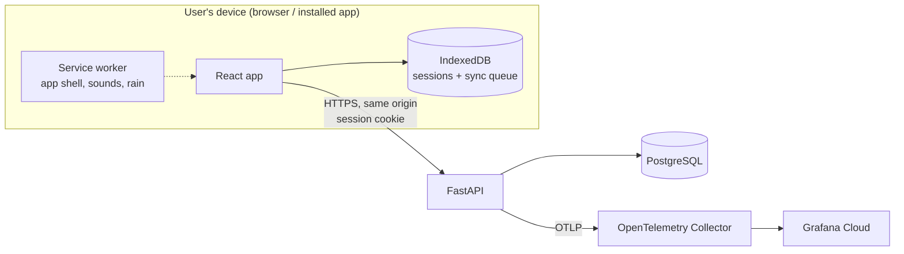

# Architecture

> **Status: outline.** Filled in by the backend and frontend agents as #6, #7 and the API issues (#8, #10–#12) land.

## Components

- **Frontend** (`frontend/`): timer engine, audio, offline storage and sync, history and settings screens. Served by the backend so app and API share one origin.
- **Backend** (`backend/`): accounts, sessions, history aggregation, settings. Owns the API contract.
- **Database:** PostgreSQL; UTC timestamps; history grouping in the user's time zone.

## Data model

To be written by #6. Planned tables: `users`, `user_settings`, `focus_sessions`, `youtube_recent_links`.

## API contract

The OpenAPI document exported from FastAPI lives at `_docs/api/openapi.json` (added by the first backend API PR). The frontend generates its TypeScript types from it.

### Conventions (from #7)

- **Error envelope.** Every non-2xx response is `{"error": {"code", "message", "details"?}}`. Validation failures are 422 with `code: "validation_error"` and `details: [{"field", "message", "type"}]`. `field` is a dotted path; client-chosen keys are never echoed (non-identifier keys show as `<key>`, unexpected extra fields as `<unknown>`), and submitted values are never returned. OpenAPI documents this as `ErrorResponse`.
- **`/healthz` vs `/readyz`.** `/healthz` means the process is up and never touches the database (liveness). `/readyz` runs `SELECT 1` with a timeout and returns 503 if the database is unreachable (readiness). The deploy script checks both.
- **Frontend serving.** The API lives under `/api` (plus `/healthz`, `/readyz`). If `frontend/dist` exists, any other unmatched GET serves the matching file or falls back to `index.html` (SPA routing). Unknown `/api/*` paths return the JSON 404. Implemented as a fallback after routing fails, so routes are never shadowed.
- **Database access.** SQLAlchemy 2 async with the asyncpg driver; `DATABASE_URL` is `postgresql+asyncpg://...`.

## Key decisions

| Decision | Why | Where |
|---|---|---|
| Timestamp-based timers | Correct time after backgrounding/reload | product_decisions F6 |
| Client-generated session UUIDs | Idempotent offline sync, no duplicates | product_decisions AC13.4 |
| Same-origin cookie auth | Simpler and safer than tokens for a web app | tech_stack §1 |
