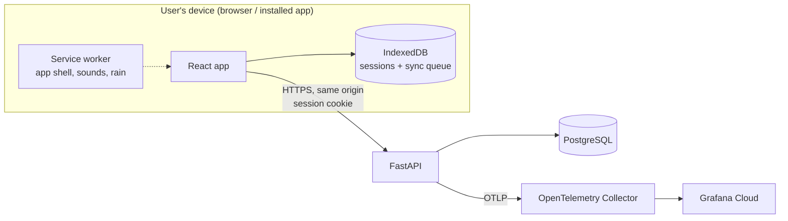

# Architecture

> **Status:** describes the app as built on `main`. The backend and frontend agents update it in the PR that changes what it describes.

## Components

- **Frontend** (`frontend/`): timer engine, audio, offline storage and sync, history and settings screens. Served by the backend so app and API share one origin.
- **Backend** (`backend/`): accounts, sessions, history aggregation, settings. Owns the API contract.
- **Database:** PostgreSQL; UTC timestamps; history grouping in the user's time zone.

## Data model

Models live in `backend/app/models/`, migrations in `backend/migrations/versions/` (Alembic, async: `migrations/env.py` uses `DATABASE_URL`). All timestamps are `timestamptz` (UTC). Primary keys are UUIDs; deleting a user cascades to their rows. Enumerated values are lower-case text with `CHECK` constraints (no Postgres enum types, so adding a value is a plain constraint change).

| Table | Columns and constraints |
|---|---|
| `users` | `id` (uuid, default generated), `email` (unique case-insensitively via an index on `lower(email)`), `password_hash`, `created_at` |
| `user_settings` | one row per user (`user_id` PK/FK): `week_start_day` 0-6 (0 = Sunday, default), `alert_volume` and `background_volume` 0-100, `keep_screen_awake`, `default_reminder_minutes` (NULL = Off, else 15/30/45/60/90/120), `pomodoro_config` (JSONB, last used), `last_tag`, `theme` (`system` default, `dark`, `light`; #214), `updated_at` |
| `auth_sessions` | sign-ins (#8): `token_hash` (PK, SHA-256 of the cookie token), `user_id` (FK, cascade), `created_at`, `expires_at` |
| `focus_sessions` | `id` (uuid, **client-generated**, no default), `user_id`, `mode` (`countdown`/`pomodoro`/`unlimited`), `tag` (`work`/`study`/`nap`/`read`/`meditation`/`exercise`), `goal` (nullable, <= 120 chars), `started_at`, `ended_at` (>= `started_at`), `focus_seconds` >= 0, `paused_seconds` >= 0, `status` (`completed`/`ended_early`), `mode_config` (JSONB), `blocks_completed` >= 0, `archived_at` (NULL = active), `created_at` |
| `youtube_recent_links` | `id`, `user_id`, `url`, `last_used_at`; unique per `(user_id, url)`. The API keeps only the 5 most recent per user |

Indexes on `focus_sessions` support history: `(user_id, started_at DESC)`, `(user_id, tag, started_at DESC)` for the tag filter, and a partial `(user_id, archived_at) WHERE archived_at IS NOT NULL` for the Archive view. Archived sessions stay in the same table (`archived_at`), so history queries add `archived_at IS NULL`.

### Migrations

- **Apply:** `make migrate` (`alembic upgrade head` against `DATABASE_URL`). The image's entrypoint (`infra/app/entrypoint.sh`) runs `alembic upgrade head` before starting the server when `MIGRATE_ON_START=1`, the default the local stack (`make up`) uses. Deploys run migrations as their own one-shot step and start the app with `MIGRATE_ON_START=0`, so a rollback only swaps the image ([deployment.md](deployment.md#app-image-and-migrations)).
- **Backward-compatible (expand/contract).** The app version being rolled back to must still work on the migrated schema, so a release only *adds* (tables, nullable or defaulted columns, indexes); removals and renames happen in a later release once no deployed version uses them. This is checked by a lint test for common cases, not proven: `tests/unit/test_migration_safety.py` fails CI if `upgrade()` calls `drop_table`, `drop_column`, `drop_constraint`, `drop_index`, `rename_table`, `alter_column`, `execute` or `exec_driver_sql` (including through aliases), or adds a NOT NULL column without a `server_default`, unless the file has a real comment line `# contract-migration: <reason>` with a non-empty reason. Reviewers still check every migration for expand/contract compliance. A drift test also fails if the models and migrations disagree (columns, server defaults, indexes and CHECK constraints).
- `downgrade()` exists for local use and is tested, but rollbacks in production redeploy the previous app version and do not downgrade the database. After a contract migration, the [rollback floor](deployment.md#rollback-floor-165) keeps rollbacks from going below it.

## API contract

The OpenAPI document exported from FastAPI lives at `_docs/api/openapi.json` (added by the first backend API PR). The frontend's API types are written by hand against it, in each module's `api.ts` (`frontend/src/*/api.ts`); nothing generates them, so an API change updates them in the same PR.

### Conventions (from #7)

- **Error envelope.** Every non-2xx response is `{"error": {"code", "message", "details"?}}`. Validation failures are 422 with `code: "validation_error"` and `details: [{"field", "message", "type"}]`. `field` is a dotted path. Submitted values are never returned. Client-chosen dict keys that are not plain identifiers show as `<key>` and unexpected extra fields as `<unknown>`; a dict key that *is* identifier-shaped (letters, digits, `_`, up to 64 characters) is shown as sent. A malformed JSON body gives `field: "body"`. OpenAPI documents this as `ErrorResponse`.
- **`/healthz` vs `/readyz`.** `/healthz` means the process is up and never touches the database (liveness). `/readyz` runs `SELECT 1` with a timeout and returns 503 if the database is unreachable (readiness). The deploy script checks both.
- **Frontend serving.** The API lives under `/api` (plus `/healthz`, `/readyz`). If `frontend/dist` exists, any other unmatched GET serves the matching file. A missing file under `assets/`, or a path whose last segment has a file extension, gets the JSON 404 (so a stale hashed asset or a service-worker request never receives HTML); any other path falls back to `index.html` (SPA routing). A future client route whose last segment contains a dot (e.g. `/history/2026.10`) would therefore 404 and needs an allow-list or a dot-free URL. Unknown `/api/*` paths return the JSON 404. Implemented as the router's "no route matched" handler, so routes are never shadowed and a 404 raised by a route itself stays a JSON 404. **Caching (#243).** Files served from `frontend/dist` carry `Cache-Control`: `public, max-age=31536000, immutable` for content-hashed files under `assets/` (`<name>-<8+ char hash>.<ext>`, as Vite emits them), and `no-cache` (store, but revalidate each use; an `ETag` makes it a 304 when unchanged) for everything else: the HTML shell (`/`, `index.html`, every SPA-fallback route), `sw.js`, `workbox-*.js`, `theme-init.js`, the web manifest, and the unhashed icons, sounds and favicon (the service worker precaches those, so revalidating costs at most a 304 and a replaced file is never stale). JSON API responses and JSON 404s get no `Cache-Control` from this code. Caddy passes the header through unchanged.
- **Accounts and auth (F1, #8).** `POST /api/auth/signup` (201, signs in), `POST /api/auth/signin`, `POST /api/auth/signout` (204, idempotent), `GET /api/auth/me`. Emails are trimmed and lower-cased; passwords are 8-128 characters and hashed with argon2id; duplicate email is 409 `conflict` with "An account with this email already exists"; wrong email or password is the same 401 for both. A sign-in sets the session cookie (random token, HTTP-only, `SameSite=Lax`, `Path=/`, no `Domain`; named `__Host-focus_session` and `Secure` when `COOKIE_SECURE=1`, plain `focus_session` over local http, since the prefix requires Secure; `Max-Age` = `SESSION_TTL_DAYS`); the server stores only the token's hash in `auth_sessions`, so sign-out revokes it server-side. Each sign-in or sign-up also deletes up to 100 expired `auth_sessions` rows. Sign-up is rate limited too: 10 per client per hour (`SIGNUP_MAX_PER_CLIENT`, `SIGNUP_WINDOW_SECONDS`), 429 `rate_limited` with `Retry-After`. Every data endpoint depends on `app.deps.CurrentUser` (401 `unauthorized` when signed out) and must scope its queries to `user.id`. Failed sign-ins are rate limited in memory per process: 5 per client+email and 20 per client within 15 minutes (429 `rate_limited` with `Retry-After`); the client is the socket peer address (IPv6 grouped by /64), so behind a proxy run uvicorn with `--proxy-headers --forwarded-allow-ips` for the proxy only.
- **Sessions (F6, F7, F11, F13, #10).** All under `/api/sessions`, all scoped to the signed-in user, and none reveals another account's data. Another user's session id is **404** on `PATCH`, `archive` and `restore`; **409** `conflict` on `POST /api/sessions` (single save); and a per-item `rejected` result with error code `conflict` in sync. `POST /api/sessions` saves one finished session (201; a repeat of the same `id` is 200 with the stored copy and changes nothing, AC13.4). `POST /api/sessions/sync` takes 1 to 100 sessions and returns **200** with `{created, existing, rejected, results}` where `results` has one `{index, id, status, session?, error?}` per item in request order; `status` is `created`, `existing` (stored copy returned) or `rejected` (`error` is `{code, message, details[]}` with `code` `validation_error`, `details[].field` relative to the item such as `focus_seconds`, or `conflict`; `id` is null when the item has no usable id). Valid items are saved even when others are rejected, so one bad session never blocks the sync queue (AC13.5). Only 401, or an envelope that isn't a `sessions` list of 1 to 100 items (422), fails the whole request; a 5xx saves nothing. Validation: `focus_seconds` 60 to 43200 (AC6.2, AC4.5); `ended_at >= started_at`; focus + paused no more than the elapsed time (2 s tolerance); `mode_config` must match `mode` and respect the F2-F4 ranges; `blocks_completed` is 0 unless Pomodoro and at most the configured blocks; datetimes must carry a UTC offset and are converted to UTC, and both `started_at` and `ended_at` must fall in [`2020-01-01T00:00:00Z`, server time + 24 h], both ends inclusive (outside it: 422 on single save, a per-item `rejected` with `validation_error` in sync; stored rows and history parameters are unaffected, #98); `paused_seconds` is at most 2 147 483 647 (the column is a 32-bit integer, a technical limit); a goal cannot contain NUL or lone surrogates. Anything a client sends that still fails inside item validation becomes a rejected item with code `invalid_session` (validation only; the insert cannot fail on a validated item, so no per-item savepoint is used). A goal has each run of line breaks (every `str.splitlines()` boundary: CR, LF, CRLF, VT, FF, U+001C-U+001E, U+0085, U+2028, U+2029; tabs are kept) replaced by one space and is trimmed before the 120-character check; blank becomes null (AC7.3, AC13.5). `PATCH /api/sessions/{id}` edits `tag` and/or `goal` (`goal: null` clears) and is 409 on an archived session (AC11.1, AC11.4); `POST .../archive` and `.../restore` are idempotent (AC11.2, AC11.5); `GET /api/sessions/archived` lists the Archive view, most recently archived first (AC11.3); `DELETE /api/sessions/archived` deletes all archived sessions and returns `{deleted: n}` (AC11.6). There is no delete for a single session (AC11.7: `DELETE /api/sessions/{id}` is 405). Field names are snake_case; the frontend's `SessionRecord` maps one to one: `startedAt`/`endedAt`/`focusSeconds`/`pausedSeconds`/`blocksCompleted`/`modeConfig` become `started_at`/`ended_at`/`focus_seconds`/`paused_seconds`/`blocks_completed`/`mode_config`, and inside the config `focusMinutes`/`breakMinutes`/`longBreakEnabled`/`longBreakMinutes`/`reminderMinutes` become `focus_minutes`/`break_minutes`/`long_break_enabled`/`long_break_minutes`/`reminder_minutes` (`mode`, `minutes`, `blocks`, `id`, `tag`, `goal`, `status` are unchanged). Log scrubbing also redacts SQLAlchemy's `[parameters: ...]`, so bound values (goals) never reach logs.
- **Settings and recent YouTube links (F12, AC8.6, #12).** `GET /api/settings` returns `week_start_day` (0 = Sunday), `alert_volume`, `background_volume` (0-100), `keep_screen_awake`, `default_reminder_minutes` (null = Off, else 15/30/45/60/90/120), `pomodoro_config` (null until first use), `last_tag` (null means Work), `theme` (`system` follows the device's light/dark setting, else `dark` or `light`; #214) and `updated_at`; a user without a row gets the defaults (80, 50, off, Sunday). `PATCH /api/settings` changes only the fields sent; out-of-range values, unknown fields and wrong types are 422. `pomodoro_config` is `{focus_minutes 5-90, break_minutes 1-30, blocks 1-8, long_break_enabled, long_break_minutes 5-60}`, all required (the frontend's `PomodoroConfig` in snake_case, without `mode`). `GET /api/youtube-links` lists the 5 most recent links, newest first, one per video or playlist id; `POST /api/youtube-links {url}` marks one as just used, drops all but the newest 5 and returns the list. A link's identity is the id the player plays (`youtube_key` in `settings_api.py`, the same parse as `findTarget` in `youtubeLink.ts`, expected values in `_docs/api/fixtures/youtube-links.json`): the video id (`youtu.be/<id>`, `v=`, `/embed|shorts|live|v/<id>`) if there is one, else the `list=` playlist id, so a video inside a playlist counts as the video. Host, scheme, `t=`/`si=`/`feature=` and parameter order don't matter. A link already listed under that id is replaced and moves to the top, with the URL just used. A link with no id is keyed by its own text. Rows saved before #249 can hold one id under several URLs: there is no migration, `GET` and `POST` collapse them (the newest stands for the id; `POST` also deletes the others, serialised per user by an advisory lock, with `ON CONFLICT` on `(user_id, url)` as a fallback so a missing lock could never turn a double paste into a 500), so a rollback needs nothing undone. `(user_id, url)` stays unique. Links must be http(s) on youtube.com, m./music./www.youtube.com, youtu.be or youtube-nocookie.com, at most 2048 characters. Links with a backslash, userinfo (`user:pass@`), a port other than the scheme default, whitespace or control characters, or a non-ASCII host are 422. Links are user content: error responses never echo them, and the log scrubber also removes SQLAlchemy's `[parameters: ...]` text from database errors.
- **History (F10, #11).** `GET /api/history?view=&tz=` with `view` `day`, `week` or `month` plus `date` (any local date in the period), `custom` plus `start` and `end` (local dates, inclusive; `end` must be before the same date 100 years after `start`), or `all` alone; a view given another view's parameters is 422. `tz` is required on every view and must be a tz database name spelled exactly, link names included (`Europe/Paris`, `UTC`, `Asia/Calcutta`; `europe/paris` is 422). Zone data comes from the `tzdata` Python package, so the accepted names don't depend on the host (Debian 13 slim images lack the link names). `tag` is also allowed on every view. Repeat `tag` to filter by any of several tags (AC10.2). Grouping is pure logic in `app/history.py`: sessions are stored in UTC and assigned to the local date they *started* on in `tz`, so a session crossing midnight counts on its start day (AC10.5) and 23 h and 25 h DST days need no special casing. Weeks start on the user's `week_start_day` setting (AC10.6). The response has `start`/`end` (the dates covered; for All time, the first and last session's dates, null with no sessions), `total_focus_seconds`, `session_count`, `tags` (tags with sessions, most focus first), zero-filled `buckets` of `{date, focus_seconds, sessions}` with `bucket` `day` (Day, Week, Month, custom up to 62 days) or `month` (All time, custom ranges of 63 days or more; `date` is the 1st, and a custom range's first and last month bars count only the days inside the range), and `sessions` newest first, as in the sessions API. Archived sessions are excluded (AC10.7). The query selects the user's sessions in a UTC window one day wider on each side, then filters on the local date in Python. Not paginated in the MVP.
- **OpenAPI.** `make openapi` rewrites `_docs/api/openapi.json`; a unit test fails when it is stale.
- **Database access.** SQLAlchemy 2 async with the asyncpg driver; `DATABASE_URL` is `postgresql+asyncpg://...`.

## Frontend timer engine (#13)

`frontend/src/timer/` holds the timer logic for all three modes, with no UI.

- **Timestamps, not ticks.** An active session is its config plus wall-clock timestamps: start, each pause and resume, each skipped break. Focus time, paused time, the Pomodoro phase and remaining time are all derived from those and the current time (`engine.ts`), so the display is correct after backgrounding, sleep or a reload. "Active time" is wall time minus paused time; Pomodoro phases are laid out along it. If the device clock jumps backwards, the engine treats the jump as zero elapsed time (timestamps are made monotonic) and caps readings taken on a fast clock at the current time, so a record never has negative durations or an end in the future and always fits the Sessions API's rules.
- **Events.** `advance(session, now)` reports what fell since the last call (`phase-change`, `reminder`, `session-end`) and, if the session reached its own end, the exact wall time it ended. The UI and sounds (#15, #16) call `TimerController.tick()` on an interval and on `visibilitychange`.
- **Several tabs, one stored session.** The stored session is the truth: the controller re-reads it before every tick and action, and the timer screen follows other tabs through the `storage` event by only reading (a `storage` handler that wrote would make two tabs write back and forth). Only the interval tick (when it reports events) and user actions write; each tab runs one call at a time, so a slow `saveRecord` can't be overtaken by a later tick. **A failed store write** (quota, private mode) from `start`, `restore`, a tick or an action doesn't throw: the change is kept in memory as unsaved, its events are reported once, `TimerUpdate.unsaved` says so, and every later call (tick or action; `restore()` too while the store still holds the session) writes it again until it succeeds, so a reload sees it after at most one more call. Memory never runs ahead of the store without that pending write. The retry only goes ahead while the store still holds the session the change was made from (an empty store for a start); if another tab has written meanwhile, the stored session wins and the unsaved change is dropped. `restore()` follows the tick rules: it adopts the stored session and writes only when it skipped events, so a second tab opening usually writes nothing and leaves another tab's pending pause alone; when it does have to write, the stored session wins and the other tab's pause is dropped. A finished session whose `pendingRecord` can't be stored is held in memory and handed to `saveRecord` anyway (it is idempotent by id); `retryPending` and `start` hand it over first, whatever the store holds. If both the store write and `saveRecord` fail, the running copy stays in the store until a retry lands, because nothing durable holds the record yet; meanwhile a reload or another tab sees it as running, and if that tab completes it first its Completed record wins over the user's stop. `current()` reads and writes nothing.
- **One active session, on the device.** `TimerController` (`controller.ts`) allows one session at a time and writes every change to an `ActiveSessionStore` (`store.ts`; `localStorage` in the app). `restore()` on app start picks the session up again; a countdown or Pomodoro that ended while the app was closed is saved as Completed at its scheduled end, and bells missed while closed aren't replayed.
- **Never lost.** A finished session's record stays in the store as `pendingRecord` until `saveRecord` (the IndexedDB session store, #19) has accepted it; failures leave it there and it is handed over again by `retryPending()`, `restore()` or the next `start()`. Sessions under 1 minute of focus are discarded with a message instead.
- **12-hour limit.** The unlimited timer stops at 12 hours of focus time (paused time excluded, like its reminders).

## Session setup screen (#14)

`frontend/src/setup/` holds the setup form: mode and settings (validated with the timer engine's `validateConfig` and limits), tag, optional goal (120 chars) and background-audio choice (None / Rain / YouTube; both play on the timer screen). Start creates the session through `TimerController`. The last-used tag and Pomodoro configuration are remembered through a `PreferencesStore`, which the app backs with the Settings API and its device cache (`SettingsPreferencesStore`, see Settings below).

## Settings and navigation (#22)

`frontend/src/settings/` holds the user's settings (F12, `GET`/`PATCH /api/settings`, #12).

- **Store (`store.ts`).** `SettingsStore` keeps `{owner, values, pending}` in `localStorage` under `ineedtofocus.settings` (the offline cache) and notifies React through `useSyncExternalStore` (`SettingsContext`). An edit is applied and saved on the device at once and recorded in `pending`; only the changed fields are sent, as a partial `PATCH`. The server's reply replaces the device's values for fields with nothing pending, so a pending local edit wins (last write wins). `refresh()` (send pending edits, then `GET`) runs at every launch (waited for only when the setup screen opens) and on the `online` event; a revision counter drops a `GET` that was overtaken by an edit, an accepted `PATCH` or another tab's edit.
- **Two tabs (#129).** Tabs share the one cache, so every change to it (an edit, an accepted send, a server copy) is a function applied to what is stored right now, under the Web Lock `ineedtofocus-settings` (unlocked where there are no Web Locks), not to the tab's older copy. `pending` therefore merges per field: edits to different fields in two tabs both survive (a closed tab's offline edit is sent by the other), and for the same field the later edit wins. Before sending or counting, and on a `storage` event, a tab takes the stored `values` and `pending` as its own (skipped while its own write is queued). A reply to a send clears a field only if it is still the value that was sent. The owner binding and the revision counter are unchanged. `theme` is merged like every other field. A send waits for the tab's queued cache writes and takes the merged cache, so it never resends an older value. Known limit: two online tabs sending the same field at nearly the same time are ordered by server arrival, not by the order of the edits; both tabs then adopt the server's reply.
- **Failures.** A network error or 5xx keeps the edit pending and retries with backoff (2 s doubling to 60 s) while the browser is online, and on `online` otherwise; Settings then shows "will sync when you're back online" (only after a send failed or while offline, not during ordinary saves). A 401 fires `notifySessionExpired()` and keeps the edit. A 422 drops only the fields the error names (all of the batch if it names none), then sends the rest.
- **One user.** The store is created per signed-in mount of `App`, bound to the user id (`signedInUserId()`), and the cache records the owner: another user's cache is ignored. `dispose()` (unmount, sign-out) aborts requests in flight and stops every later write, so an in-flight `PATCH` that resolves after sign-out cannot rewrite the cache or be sent under the next account. `arm()` restarts a disposed store (StrictMode runs an effect's setup, cleanup and setup again on the same instance) unless its user is gone. `flush()` and `refresh()` are what the sync engine (#19) can adopt in place of the store's own triggers.
- **Adapters (`adapters.ts`).** `SettingsPreferencesStore` backs the setup screen's `PreferencesStore` (`last_tag`, `pomodoro_config`; null tag means Work; only changed fields are sent). `SettingsAlertVolumeStore` backs the `AlertPlayer` with `alert_volume`. Keep screen awake is `keep_screen_awake` (`useKeepAwakeSetting`); the default reminder pre-selects the unlimited timer's reminder. Nothing reads the old device-local keys. The `theme` setting (System / Dark / Light, #214) is applied by `theme.ts` as `data-theme` on `<html>` (System leaves it off so `prefers-color-scheme` decides in `index.css`); `public/theme-init.js` sets it from the device copy before first paint; the timer and summary screens stay dark in every mode (AC9.1).
- **Launch.** On a launch that ends on the setup screen, `App` waits up to 1.5 s for the first `refresh()` so another device's tag and Pomodoro config pre-fill it (it reads them once); offline or slow, it opens from the device copy. A restored session never waits.
- **Navigation (`nav/`).** `ScreenNav` lists the top-level screens from `screens.ts`: New session (`/`), History (`/history`), Archive (`/archive`) and Settings (`/settings`). Every one of them shows it; the timer and summary do not. URLs and the back button: [Screens and URLs](#history-screen-20).

## History screen (#20)

`frontend/src/history/` holds the History screen (F10): `api.ts` (the `GET /api/history` client, snake_case to camelCase), `model.ts` (pure date, period and merge logic) and `HistoryScreen.tsx`.

- **Screens and URLs.** There is no router. `nav/screens.ts` lists the top-level screens (`SCREENS`) and maps them to URLs: `/` is the setup screen, `/history` History, `/archive` Archive and `/settings` Settings. `App` switches screens with `goTo`, which calls `history.pushState` and sets the view; a `popstate` handler follows the back and forward buttons between screens that have URLs, and never takes over a running timer or a summary. A deep link to one of them (e.g. `/history`) opens that screen once the timer has been restored (a running session still shows the timer). The summary's "View history" link keeps `href="/history"` and switches screens in place. The paths have no dot, so the backend serves `index.html` for them.
- **Requests.** `tz` is the device's IANA zone, or `UTC` if it reports none (AC10.5). Day, Week and Month send `date` (the screen's anchor, moved by previous/next); Custom sends `start` and `end` (the form refuses an end before the start); All time sends neither; selected tags are repeated `tag` params. Weeks start on `week_start_day`, which the server applies. The chart follows the response's `bucket` unit (day or month bars), and the Day view has no chart.
- **Device sessions are merged in (AC10.9).** After each answer the screen reads the signed-in owner's sessions from `SessionStore.list(owner)` (none if no owner is known, never another account's). Sessions the server doesn't have yet (`syncState !== 'synced'`, whether `pending` or `rejected`) and that aren't archived are added to the list, totals, per-tag breakdown and chart when their local start date is in the period and their tag passes the filter. They are selected by upload state, not by the badge, so a synced session with a queued edit is neither added nor counted as "not saved". De-duplication is by session id; the server's copy wins. The badge ("Not synced yet" / "Couldn't sync") comes from the store's `indicator`. **It follows the sync engine (#264).** `SyncEngine.onChange(listener)` calls the listener once after each `syncNow()` run in which any pass of its loop changed something on the device (a session synced or refused, an edit applied, dropped or refused); a run whose passes all found nothing, or a caller that joined a run already going, adds no call. A pass run by another tab doesn't refresh this tab's History (the engine only notifies its own listeners); it shows the change on its next load. An open History subscribes and reloads once, so the "not saved" note, its count and the badges update without a reload or remount, and no request is made beyond that one History load.
- **Offline.** If the request fails (network, 5xx, timeout) the screen shows the last answer for that same query kept in memory, or an empty view of the period, with every non-archived session of the owner on the device merged in, and a note that sessions from other devices may be missing. A 401 also fires the session-expired event (the sign-in is re-checked). A 422 shows an error instead. The `online` event reloads the view.

- **Edit and archive (F11, #21).** Each History row has Edit and Archive. Edit (tag, one-line goal of at most 120 characters; times can't change) goes through `SessionStore.edit` and the sync engine for a session on the device, so it shows at once with its "Not synced yet" badge and is sent as a `PATCH` (offline too). A session only the server has (finished on another device) is patched directly while online. Archive and restore are **online only**: the row (and its time in totals, tags and bars) goes at once, the call follows, and the row comes back with a message if the server doesn't confirm; a queued edit is sent first, and the archive is refused (the row comes back with "your change hasn't synced yet") while that edit can't be sent. A failed archive leaves the offline History cache untouched. The "archived on another device" message shows only when the sync engine reports the edit as dropped after a 409 (`SyncReport.dropped`, gathered across every pass of a `syncNow()` loop), never for an edit applied earlier, dropped by another tab, or while the same session is being archived. After Save, focus returns to that row's Edit button once the list has reloaded. "Session archived. Undo" calls restore. A session not yet saved to the account can't be archived (the server doesn't have it). **A way out of "Couldn't sync" (#139).** A row whose queued edit the server refused (404 or 422, `editState: 'rejected'`) offers **Discard change** (the Archive button is replaced by "Can be archived once the change is discarded." until then). It asks first ("Discard this change? The session keeps its last synced tag and goal."; an `alertdialog` with Cancel focused; Cancel or Escape returns focus to the Discard button) and, on confirm, `SessionStore.discardEdit` removes the edit, the row shows the synced tag and goal and focus goes to its Edit button. A session the server rejected (`syncState: 'rejected'`) offers **Archive on this device only** instead of the "synced first" hint: `SessionStore.archiveOnDevice` sets `archivedAt` on the device copy (online or offline), nothing is sent, and the row leaves History and totals at once with "Session archived on this device only. Undo" (`restoreOnDevice`). A device-only archived session is a rejected session with `archivedAt` set; it stays `rejected`, so it is still counted as unsynced at sign-out until deleted, and never uploaded. `setArchived`, `markGone` and so the cross-device reconcile ignore anything that isn't `synced`, so the server's archive and delete never touch it. The Archive screen reads these from the device store next to the server's list (also when that list can't be loaded), marks them "Only on this device", restores them without a request, and "Delete all archived sessions" counts them in the number it states and deletes them from the device with the others (`removeArchived`; if that device-side delete fails, the screen says so, keeps those rows listed and doesn't count them as deleted). Server and device-only rows form one list, most recently archived first (#253). The Discard confirmation on a History row makes the row's Edit button inert while it is open, and after a failed discard puts focus back on the Discard button with the error shown; a late reply to a server-archive Undo clears only its own Undo message, not a newer one. The device copy follows the server through `SessionStore.setArchived`, and History leaves archived device sessions out online and offline. The **Archive** screen (`/archive`, in the navigation, with the account bar and Sign out like History and Settings) lists `GET /api/sessions/archived` read-only, with Restore per row and "Delete all archived sessions", which asks first ("Permanently delete N archived sessions? This can't be undone.", Cancel focused) and then reports the count the server deleted. Delete all first clears any earlier Archive message; when nothing was deleted (the server had none and no device-only row), it says "Deleted 0 archived sessions.". **Cross-device reconcile (#133).** Archive and delete elsewhere reach the device only through an online load (`sync/reconcile.ts`). An online History load takes the device's synced, non-archived sessions in the viewed period (the server's `start`, `end` and `time_zone`; every synced one in All time) that the server's list lacks, and loads the Archive list: those in it are marked archived on the device. Those in neither answer are **marked `goneOnServer` and hidden at once, but kept (#227)**: `SessionStore.markGone` stores the mark time on the device copy, and History (online and offline) and its totals leave a marked session out. The copy is deleted (with an edit that could never be sent) only when a **later pair confirms it**: a History load that started after the mark was set, plus the Archive list loaded for it, still miss the id. A load that started before the mark was written (a concurrent one) doesn't confirm. If the id shows up again, in the History answer or the Archive list (restored on another device, or the server restored a backup), the mark is cleared (`clearGone`, or `setArchived`, which also records an archive) and it shows again. Marked sessions are synced ones without a pending edit, so they aren't counted as unsynced at sign-out: nothing on the device was waiting to reach the server, and the next load pair deletes them anyway; sign-out removes them with the rest of the owner's data. The exception is a marked session whose queued edit the server refused (`editState: 'rejected'`, the 404 after a delete elsewhere): its row is hidden, so **Discard change** can't be reached (discarding wouldn't help, the session is gone), but it is still counted as an edit at sign-out until the next confirming pair deletes the copy. `loadStartedAt` is a required argument of `reconcileMissing` and `reconcileArchivedGone`, taken before the request is sent, so a caller can't confirm a mark with a later default. Device-only archived sessions (#246) and sessions not yet synced are never marked or deleted. Limits: nothing is checked with a tag filter on, for sessions not yet synced, for ones being archived here, or for ones within 3 hours of a period's edge (browser and server tz data can differ); nothing changes if the Archive list can't be loaded; a session with a pending edit is never marked or removed (a deleted one gets a 404 on its edit, which turns `rejected`, and the next two loads mark and remove it); a session deleted elsewhere is hidden by the first view that contains it and removed by the next such load (a later online load is needed, which can be a sync-triggered History reload in the same visit, so a deleted session lingers one load longer than before); because of the 3 h edge margin, one within 3 h of the edge of every view that contains it is cleaned up only by a wider view or All time. An Archive load marks every listed session archived on the device (except ones restored on that screen since the load). It also handles the reverse (#263): a synced device copy already marked archived that the list no longer shows (deleted on another device) gets the same mark-then-confirm rule through `reconcileArchivedGone` (`markGone` the first time, deleted by a later Archive load that started after the mark), only when the list loaded, never for device-only archived (#246), unsynced or pending-edit sessions, nor for ids restored on that screen. The copy is already hidden by its archived mark, so the user sees no change. "Delete all archived" also removes the device copies of the ids it listed, as loaded: a session restored on another device after the screen loaded loses only its device copy (the server's stays, and the next online History load brings it back). An online History load also clears the archived mark of a device session the server lists as live (restored on another device), so offline History shows it again; sessions being archived or archived-and-not-undone on that screen, and ones with an Undo under way, are left alone, as is any mark an in-flight reconcile would write after Undo. Limit: after an Undo (also if Undo's `setArchived(null)` fails) that id stays skipped until the screen remounts, so on that mount an archive or delete of the session elsewhere isn't followed and offline History keeps showing it. Limit: a session restored on another device, then two Archive loads with no History load in between, loses its device copy (the second Archive load confirms the mark; the server keeps the session and the next online History load shows it). Limit: two load pairs a moment apart during a long server outage-and-restore from an older backup still delete the device copy. Yacine ruled on 2026-10-25 (decision log) to keep the two-load-pair rule and no longer-lived copies: a restore from an older backup is an operator incident handled outside the app.

## Background rain (#17)

`frontend/src/sounds/rain.ts` has `RainPlayer`: it decodes `public/audio/rain.mp3` (precached by the service worker, so it works offline) and loops it gaplessly with an `AudioBufferSourceNode` (`loop = true`, `loopStart`/`loopEnd` to leave out the MP3's encoder padding; see `_docs/assets.md`). It shares the `AlertPlayer`'s audio context, so the same unlock on the first gesture covers both, and it never sets `navigator.audioSession.type`. Gain ramps over 40 ms on start, pause and stop. `AudioControls` (in the timer screen's `audioControls` slot) plays while the timer runs, including through breaks, pauses with the timer and stops when the screen goes away. The background volume (0-100, default 50, separate from the alert volume) is the Settings API's `background_volume` (through `SettingsBackgroundVolumeStore`, the same value the Settings screen edits); the chosen source is kept in `ineedtofocus.audioSource` while a session is active, so a reload restores it. Offline with YouTube chosen, the setup and timer screens suggest Rain (AC8.7).

`frontend/src/sounds/YoutubeControls.tsx` and `youtubePlayer.tsx` play YouTube as the background source (F8.4-F8.6, #18). The IFrame Player API is loaded from `https://www.youtube.com/iframe_api` (`ytApi.ts`; never bundled or cached by the service worker, and given up on after 15 s) and the player uses the `www.youtube-nocookie.com` host. It stays visible, loops (`loop` + `playlist` for a video, `setLoop` for a playlist), follows the timer like Rain (plays while it runs, pauses with it, destroyed when the screen goes away) and takes the same `background_volume`. A player that errors is stopped and removed, with a message; the session carries on. The exception is a playlist item that fails with error 100, 101 or 150 after something has played (#203): it is skipped with `nextVideo()` and a note ("Skipped a video that can't be played here.", shown for 5 s in a `role="status"` region), unless that index was already skipped. The player is removed only after as many errors in a row as the playlist has items (3 if the length is unknown); a playing item resets the run. Error 2, errors before anything played, and single videos still remove the player at once. The player is built only from the video or playlist id parsed by `youtubeLink.ts`, never from the pasted string. That client check mirrors the server's `_check_youtube_url` (http/https, the YouTube hosts read from the raw text, at most 2048 characters, no backslash, userinfo, non-default port, non-ASCII host, or any Unicode C/Z character; a missing scheme gets `https://`) and also needs an id in the link. Python and the browser ship different Unicode versions, so the client percent-encodes every non-ASCII character in the path, query and fragment, saves and POSTs that encoded form and counts the 2048 limit on it; the server then only sees ASCII. Both checks run the cases in `_docs/api/fixtures/youtube-links.json`. The session's link is kept in `ineedtofocus.youtubeLink`, cleared with `ineedtofocus.audioSource` when the session ends and on sign-out. The 5 recent links come from `GET/POST /api/youtube-links`; the list shows each video or playlist id once (`showRecent` keeps the newest entry per id, the same rule as the server's `youtube_key`, which also resolves dot segments such as `/foo/../embed/<id>` as the browser's `new URL()` does); both calls fail quietly, since playback never depends on them. Links are never logged.

## Accounts UI (#9)

`frontend/src/auth/` gates the app behind sign-in (guest mode is out of scope). `main.tsx` wraps `App` in `AuthGate`, which asks `GET /api/auth/me` on load: 200 shows the app, 401 shows `AuthScreen` (sign in / create account; signing up also signs in).

- **Offline remembered user.** After a successful `/me`, sign-in or sign-up the user is cached in `localStorage` (`ineedtofocus.user`). If `/me` then fails because the device is offline, times out (5 s) or the server answers 5xx, the cached user keeps the app open so the timers work offline (F13). Without a cached user the sign-in screen is shown.
- **Local data belongs to one user.** `ineedtofocus.owner` holds the id of the user whose data is on the device. A 401 on `/me` (30-day expiry, revoked elsewhere) is not a sign-out: the sign-in screen shows but the data stays for its owner. The same user signing in again keeps it all. A different user signing in first calls each hook's `quarantine(previousOwnerId)` (time-limited), which keeps the previous owner's finished session under them (#19, see below), then removes the previous owner's settings (with any edits not yet sent), active session and the keys of earlier versions. If a finished session of theirs is still in the timer's store after that, it is parked rather than deleted; if it can't even be parked, the active session is left in place. The record is never handed to `saveRecord` for the new account. A 401 from a data request (sync) fires `ineedtofocus:session-expired`, and AuthGate re-checks `/me` as it does at start-up: an expired sign-in keeps the data. If a timer is running or paused (or its summary is open), AuthGate stays mounted in an `expired` state (#120): the cached user is forgotten, so sync and settings send nothing, but `ineedtofocus.owner` and the active session's owner stay, and the timer, sounds and wake lock keep working. A second 401 changes nothing. `App` calls `leaveExpired()` once the view is neither timer nor summary, and only then does sign-in show; the finished session is saved under its owner and synced after the same user signs in again. A different user signing in goes through the quarantine above. Another tab removing the cached user does not sign out a tab with a running timer, and the same user signing in again elsewhere ends the expired state.
- **Sign out.** The account bar (`AccountBar`, via `AccountContext`) is rendered on the setup, History, Archive and Settings screens, never over the timer or summary. It is refused with "End your session before signing out." while a running or paused session is stored. Otherwise it calls `retryPending()` and the registered hooks' `trySync()` (the session store's waits at most 10 s and is skipped offline), then counts unsynced data as `{sessions, edits, settings}` (`pendingRecord` plus hooks' `countUnsynced()`). `trySync()` calls run side by side, so the whole wait stays within 10 s. `App` registers a settings hook (`settings/hook.ts`, `settingsDataHook(store)`) while it is mounted: `trySync()` sends pending settings edits (`PATCH /api/settings`, same 10 s limit, skipped offline) and `countUnsynced()` reports `settings` (fields still pending, other tabs' included, #129). If any remains it asks "N sessions haven't synced and will be deleted from this device." (plus "Some changes to sessions haven't synced either." when edits are queued, then "Some settings changes haven't synced and will be deleted from this device." when settings edits are unsent; alone, that line is the whole message) with Cancel (focused) and "Sign out anyway". "Sign out anyway" checks again for a timer started in another tab meanwhile and refuses if there is one. Then it calls `POST /api/auth/signout` and clears an explicit list (`localData.ts`): first each hook's `clear()` (while the user is still on record; a hook that throws doesn't stop the rest and nothing is logged), then settings (`ineedtofocus.settings`), active session and its owner, the legacy keys `ineedtofocus.preferences`, `ineedtofocus.keepAwake` and `ineedtofocus.alertVolume` (removed, never read), cached user and owner. Other keys, other storage and Cache Storage are untouched; IndexedDB is touched only through hooks. Modules like the session store (#19) register a `LocalDataHook` (`countUnsynced`, `trySync`, `clear`, optional `quarantine`; `countUnsynced` may add `settings`) with `registerLocalDataHook`; `main.tsx` registers the session store's before sign-in is checked. A `storage` listener signs the other tabs out. If the API answers 5xx the user stays signed in with "Couldn't sign out. Try again."
- **Offline sign-out.** If the sign-out call fails with a network error or timeout (10 s), the device signs out locally (data cleared as above) and sets `ineedtofocus.pendingLogout` (no personal data; the clear list does not remove it). The sign-in screen says "You're signed out on this device. Your account will be fully signed out the next time this device is online." While the marker is set, `/me` is never called and the device is never treated as signed in. The logout call is retried at start-up, on the `online` event and before every sign-in or sign-up request (which waits for it); only 2xx or 401 removes the marker; any other outcome (network error, timeout, 5xx, 429, …) keeps it. While it fails, sign-in and sign-up are refused and the request is not sent: a network error or timeout shows "Can't finish signing out yet. Connect to the internet, then try again."; any other failure (5xx, 429, other non-2xx) shows "Can't finish signing out yet. The server couldn't be reached. Try again shortly." Known limit: until the device is back online (or the cookie expires after 30 days) the server session stays valid.
- **Error mapping** (`api.ts`): 401 gives one generic "Incorrect email or password"; 409 shows on the email field; 422 with `details[].field == "password"` shows the 8-128 message (sign-up and sign-in); 429 shows the wait from the `Retry-After` header; network and 5xx errors have their own kinds. The forms validate email shape and password length before calling the server and move focus to the first invalid field.

## Offline storage and sync (#19)

`frontend/src/sync/` keeps finished sessions on the device and sends them to the server (F13).

- **Device first.** The timer's `saveRecord` (`deviceSaver`) writes the finished session to IndexedDB (Dexie, database `ineedtofocus`, table `sessions`) and only then asks the sync engine to send it (AC13.2). The write has a 4-second limit: past it the timer shows "Not saved yet", keeps the record as its `pendingRecord`, and the app retries every 10 seconds while the summary is shown (and on the next start or reload), so a stalled IndexedDB never freezes the timer screen.
- **Sync state per session.** Each stored session is `pending` ("not synced yet"), `synced`, or `rejected` ("Couldn't sync": kept on the device, never retried automatically, never blocking others). `SessionStore.list(owner)` returns each session with its `indicator` (`not-synced-yet` / `couldnt-sync` / `synced`) for history (#20, AC10.9).
- **Sync engine** (`SyncEngine`): sends pending sessions in batches of up to 100 to `POST /api/sessions/sync` and applies the per-item results. Retries are idempotent by the client-generated id (AC13.4). A network error, timeout, 5xx, 429 or malformed reply keeps everything and retries with exponential backoff (2 s doubling to 5 min, with jitter); a 401 keeps everything and waits for the next trigger. Triggers: app start, after each save, the `online` event, the app becoming visible, and the backoff timer. One pass runs at a time (Web Locks across tabs). The single-save endpoint `POST /api/sessions` isn't used.
- **Edits.** A tag/goal edit is stored beside the session (never merged into it) and sent as `PATCH /api/sessions/{id}` once the session is synced, never as a re-save. 409 (archived elsewhere) drops the edit, leaves the session as the server has it and marks the device copy archived (#133); 404 or 422 keeps the edit as "Couldn't sync" (AC11.4); for a 404 (deleted elsewhere), the next online load of that period removes the session with its stuck edit (#133). A version counter stops a reply to an older edit from clearing a newer one.
- **Owners.** Every stored session (and so its edit) carries the id of the user who was signed in when it started (`signedInUserId()` in `auth/localData.ts`: the cached `ineedtofocus.user`, provided `ineedtofocus.owner` is unset or the same id; `OwnedActiveSessionStore` remembers the running session's owner in `ineedtofocus.activeSessionOwner`). Sync sends and history shows only the signed-in user's sessions; another account's stay quarantined on the device until that user signs in again. A session finished with nobody signed in has no owner and is never synced. A sync pass stops if the signed-in user changes mid-pass.
- **Time limits inside a pass.** Every device-store call in a sync pass has a 4-second limit, so a stalled IndexedDB fails the pass (kept, retried with backoff) and releases the cross-tab lock. A 401 calls `onUnauthorized` (the accounts UI re-checks the sign-in); a change of signed-in user mid-pass ends it as `owner-changed`.
- **Quarantine and the parked shelf.** On a different user's sign-in, `quarantine(previousOwnerId)` takes the previous owner's finished session from the timer's store: a `pendingRecord`, or a countdown/Pomodoro that reached its end while the app was closed (Completed, AC6.5). A session still running isn't moved. It writes the session to IndexedDB under that owner within 4 s; if the write fails or stalls, the session is parked in localStorage (`ineedtofocus.quarantine.pending`, a list of `{ownerId, record}`, outside the per-user keys). The shelf is drained into IndexedDB at start-up, every minute while the app is open (`PARKED_DRAIN_MS`) and after each successful save, one pass at a time per tab; each entry is removed only after its write has landed. Every read-modify-write of the list (park, remove) runs under the Web Lock `ineedtofocus-parked`, so two tabs can't overwrite each other's entries (without Web Locks it runs unlocked). The lock keeps the list consistent; it does not keep tabs' passes apart, so two tabs can both write the same entry to IndexedDB, which is harmless because saving is idempotent by id. A drain pass looks at each entry again under the lock, and holds the lock until its write has landed and the entry is off the shelf (at most 4 s for a stalled write), so a sign-out (`clearParked`) waits its turn and can't leave a later entry to be saved after that owner's data was cleared. `claimLocalData` bounds its own `parkSession` like the quarantine hook, so a lock that is never granted can't hold sign-in; the timer then keeps its copy. A finished session still in the timer's store under a different owner than the signed-in user (a `pendingRecord`, or a countdown/Pomodoro past its end, AC6.5) is handed over under its owner and its summary is skipped (`isForeignSession`); an expired sign-in (no user signed in) does not hide it. If that hand-off can't be saved, it is retried on the pending-retry interval and the setup screen says so until it lands. A session still *running* under a different owner is discarded at start-up (`discardForeignRunning`), as a different user's sign-in does, so their goal and tag never reach the timer screen. Parked sessions are counted and cleared with their owner's data, and are never shown to or synced into anyone else.
- **Sign-out hook** (a `LocalDataHook` in #9's registry, registered by `main.tsx` at start-up): `countUnsynced()` (`{sessions, edits}` for the signed-in user), `trySync()` (one last sync, at most 10 s, skipped offline), `clear()` (deletes only the signed-in user's sessions and parked sessions; does nothing when no user is known) and `quarantine(previousOwnerId)` (moves a previous owner's `pendingRecord` into the store under them before a different user's sign-in clears the active session).
- **Service worker** (vite-plugin-pwa, Workbox `generateSW`): precaches the app shell, icons and any audio under `public/sounds/` or `public/audio/` (the list is `OFFLINE_ASSETS` in `frontend/vite.config.ts`); navigations fall back to the cached `index.html`, except `/api/*`, `/healthz` and `/readyz`, which always go to the network. A new version takes over by itself when the app is idle (#244): no banner, never during a timer or summary. The worker is registered from `main.tsx` through `virtual:pwa-register` (`registerType: 'prompt'`, `injectRegister: false`), and `frontend/src/update/` decides when to call `skipWaiting` and reload. The app is **idle** when this tab shows setup, History, Archive or Settings (not the timer, a summary or the start-up restore); no form is mid-edit (a focused text field, a History edit form, a goal with text in it, an open Discard/Delete dialog); and no tab has a stored session (`ineedtofocus.activeSession`, running, paused or a `pendingRecord` not yet handed over). Idleness is checked when the worker starts waiting, on every screen change, when the page becomes visible, on storage events from other tabs and every 5 s while an update waits; it is checked again after the flush. Before activating, the app sends settings edits and the sync queue (bounded to 10 s; what doesn't go is already on the device in localStorage or IndexedDB, so the reload loses nothing). Activating makes every tab's worker change, which would reload each tab; each tab therefore reloads itself (`onNeedReload`) only when it is idle too, and a busy one waits. It checks for a newer worker when the page becomes visible and hourly (`registration.update()`). A `sessionStorage` timestamp refuses a second reload within a minute (no reload loop). A page no worker controls (a first visit or a hard reload) gets no `controlling` event, so it reloads once, when idle, after the new worker is active. A busy tab can end up controlled by the new worker while it still runs the old page: that is safe today (`/api/*` is never handled by the worker, sounds and audio keep stable precached URLs, and the only lazy chunk, `workbox-window`, loads at start-up), but precache cleanup deletes the old hashed files, so a future lazy-loaded route chunk would fail to load in such a tab. Code-splitting needs a plan for that (for example, reload on a chunk-load error). A signed-out tab never auto-updates: `App` is not mounted on the sign-in screen, so the tab counts as busy until signed in. The setup form holds an update while it is dirty (any field changed from its loaded value). Tabs on the release before #244 have no updater and switch only once every tab is closed or on a hard reload. Precache and the navigation fallback are unchanged. The web manifest and icons (`frontend/public/icons/`, drawn by `frontend/scripts/make-icons.mjs`) make the app installable.

## Key decisions

| Decision | Why | Where |
|---|---|---|
| Timestamp-based timers | Correct time after backgrounding/reload | product_decisions F6 |
| Client-generated session UUIDs | Idempotent offline sync, no duplicates | product_decisions AC13.4 |
| Same-origin cookie auth | Simpler and safer than tokens for a web app | tech_stack §1 |
