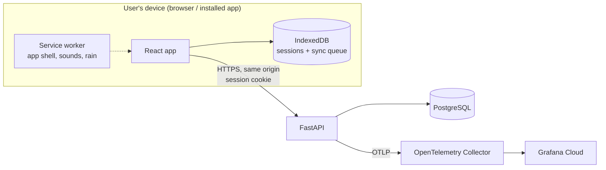

# Architecture

> **Status: outline.** Filled in by the backend and frontend agents as #6, #7 and the API issues (#8, #10–#12) land.

## Components

- **Frontend** (`frontend/`): timer engine, audio, offline storage and sync, history and settings screens. Served by the backend so app and API share one origin.
- **Backend** (`backend/`): accounts, sessions, history aggregation, settings. Owns the API contract.
- **Database:** PostgreSQL; UTC timestamps; history grouping in the user's time zone.

## Data model

Models live in `backend/app/models/`, migrations in `backend/migrations/versions/` (Alembic, async: `migrations/env.py` uses `DATABASE_URL`). All timestamps are `timestamptz` (UTC). Primary keys are UUIDs; deleting a user cascades to their rows. Enumerated values are lower-case text with `CHECK` constraints (no Postgres enum types, so adding a value is a plain constraint change).

| Table | Columns and constraints |
|---|---|
| `users` | `id` (uuid, default generated), `email` (unique case-insensitively via an index on `lower(email)`), `password_hash`, `created_at` |
| `user_settings` | one row per user (`user_id` PK/FK): `week_start_day` 0-6 (0 = Sunday, default), `alert_volume` and `background_volume` 0-100, `keep_screen_awake`, `default_reminder_minutes` (NULL = Off, else 15/30/45/60/90/120), `pomodoro_config` (JSONB, last used), `last_tag`, `updated_at` |
| `focus_sessions` | `id` (uuid, **client-generated**, no default), `user_id`, `mode` (`countdown`/`pomodoro`/`unlimited`), `tag` (`work`/`study`/`nap`/`read`/`meditation`/`exercise`), `goal` (nullable, <= 120 chars), `started_at`, `ended_at` (>= `started_at`), `focus_seconds` >= 0, `paused_seconds` >= 0, `status` (`completed`/`ended_early`), `mode_config` (JSONB), `blocks_completed` >= 0, `archived_at` (NULL = active), `created_at` |
| `youtube_recent_links` | `id`, `user_id`, `url`, `last_used_at`; unique per `(user_id, url)`. The API keeps only the 5 most recent per user |

Indexes on `focus_sessions` support history: `(user_id, started_at DESC)`, `(user_id, tag, started_at DESC)` for the tag filter, and a partial `(user_id, archived_at) WHERE archived_at IS NOT NULL` for the Archive view. Archived sessions stay in the same table (`archived_at`), so history queries add `archived_at IS NULL`.

### Migrations

- **Apply:** `make migrate` (`alembic upgrade head` against `DATABASE_URL`). Deploys run `alembic upgrade head` before the app starts; the wiring lands with whichever of the compose app service (#4) and the schema (#6) merges second.
- **Backward-compatible (expand/contract).** The app version being rolled back to must still work on the migrated schema, so a release only *adds* (tables, nullable or defaulted columns, indexes); removals and renames happen in a later release once no deployed version uses them. This is enforced by `tests/unit/test_migration_safety.py`, which fails CI if `upgrade()` calls `drop_table`, `drop_column`, `drop_constraint`, `drop_index`, `rename_table`, `alter_column` or raw `execute` unless the file carries a `# contract-migration: <reason>` comment, making the exception explicit in review. A drift test also fails if the models and migrations disagree.
- `downgrade()` exists for local use and is tested, but rollbacks in production redeploy the previous app version and do not downgrade the database.

## API contract

The OpenAPI document exported from FastAPI lives at `_docs/api/openapi.json` (added by the first backend API PR). The frontend generates its TypeScript types from it.

### Conventions (from #7)

- **Error envelope.** Every non-2xx response is `{"error": {"code", "message", "details"?}}`. Validation failures are 422 with `code: "validation_error"` and `details: [{"field", "message", "type"}]`. `field` is a dotted path; client-chosen keys are never echoed (non-identifier keys show as `<key>`, unexpected extra fields as `<unknown>`), and submitted values are never returned. OpenAPI documents this as `ErrorResponse`.
- **`/healthz` vs `/readyz`.** `/healthz` means the process is up and never touches the database (liveness). `/readyz` runs `SELECT 1` with a timeout and returns 503 if the database is unreachable (readiness). The deploy script checks both.
- **Frontend serving.** The API lives under `/api` (plus `/healthz`, `/readyz`). If `frontend/dist` exists, any other unmatched GET serves the matching file or falls back to `index.html` (SPA routing). Unknown `/api/*` paths return the JSON 404. Implemented as a fallback after routing fails, so routes are never shadowed.
- **Database access.** SQLAlchemy 2 async with the asyncpg driver; `DATABASE_URL` is `postgresql+asyncpg://...`.

## Key decisions

| Decision | Why | Where |
|---|---|---|
| Timestamp-based timers | Correct time after backgrounding/reload | product_decisions F6 |
| Client-generated session UUIDs | Idempotent offline sync, no duplicates | product_decisions AC13.4 |
| Same-origin cookie auth | Simpler and safer than tokens for a web app | tech_stack §1 |
