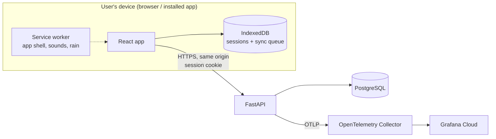

# Architecture

> **Status: outline.** Filled in by the backend and frontend agents as #6, #7 and the API issues (#8, #10–#12) land.

## Components

- **Frontend** (`frontend/`): timer engine, audio, offline storage and sync, history and settings screens. Served by the backend so app and API share one origin.
- **Backend** (`backend/`): accounts, sessions, history aggregation, settings. Owns the API contract.
- **Database:** PostgreSQL; UTC timestamps; history grouping in the user's time zone.

## Data model

Models live in `backend/app/models/`, migrations in `backend/migrations/versions/` (Alembic, async: `migrations/env.py` uses `DATABASE_URL`). All timestamps are `timestamptz` (UTC). Primary keys are UUIDs; deleting a user cascades to their rows. Enumerated values are lower-case text with `CHECK` constraints (no Postgres enum types, so adding a value is a plain constraint change).

| Table | Columns and constraints |
|---|---|
| `users` | `id` (uuid, default generated), `email` (unique case-insensitively via an index on `lower(email)`), `password_hash`, `created_at` |
| `user_settings` | one row per user (`user_id` PK/FK): `week_start_day` 0-6 (0 = Sunday, default), `alert_volume` and `background_volume` 0-100, `keep_screen_awake`, `default_reminder_minutes` (NULL = Off, else 15/30/45/60/90/120), `pomodoro_config` (JSONB, last used), `last_tag`, `updated_at` |
| `auth_sessions` | sign-ins (#8): `token_hash` (PK, SHA-256 of the cookie token), `user_id` (FK, cascade), `created_at`, `expires_at` |
| `focus_sessions` | `id` (uuid, **client-generated**, no default), `user_id`, `mode` (`countdown`/`pomodoro`/`unlimited`), `tag` (`work`/`study`/`nap`/`read`/`meditation`/`exercise`), `goal` (nullable, <= 120 chars), `started_at`, `ended_at` (>= `started_at`), `focus_seconds` >= 0, `paused_seconds` >= 0, `status` (`completed`/`ended_early`), `mode_config` (JSONB), `blocks_completed` >= 0, `archived_at` (NULL = active), `created_at` |
| `youtube_recent_links` | `id`, `user_id`, `url`, `last_used_at`; unique per `(user_id, url)`. The API keeps only the 5 most recent per user |

Indexes on `focus_sessions` support history: `(user_id, started_at DESC)`, `(user_id, tag, started_at DESC)` for the tag filter, and a partial `(user_id, archived_at) WHERE archived_at IS NOT NULL` for the Archive view. Archived sessions stay in the same table (`archived_at`), so history queries add `archived_at IS NULL`.

### Migrations

- **Apply:** `make migrate` (`alembic upgrade head` against `DATABASE_URL`). Deploys run `alembic upgrade head` before the app starts; the wiring lands with whichever of the compose app service (#4) and the schema (#6) merges second.
- **Backward-compatible (expand/contract).** The app version being rolled back to must still work on the migrated schema, so a release only *adds* (tables, nullable or defaulted columns, indexes); removals and renames happen in a later release once no deployed version uses them. This is checked by a lint test for common cases, not proven: `tests/unit/test_migration_safety.py` fails CI if `upgrade()` calls `drop_table`, `drop_column`, `drop_constraint`, `drop_index`, `rename_table`, `alter_column`, `execute` or `exec_driver_sql` (including through aliases), or adds a NOT NULL column without a `server_default`, unless the file has a real comment line `# contract-migration: <reason>` with a non-empty reason. Reviewers still check every migration for expand/contract compliance. A drift test also fails if the models and migrations disagree (columns, server defaults, indexes and CHECK constraints).
- `downgrade()` exists for local use and is tested, but rollbacks in production redeploy the previous app version and do not downgrade the database.

## API contract

The OpenAPI document exported from FastAPI lives at `_docs/api/openapi.json` (added by the first backend API PR). The frontend generates its TypeScript types from it.

### Conventions (from #7)

- **Error envelope.** Every non-2xx response is `{"error": {"code", "message", "details"?}}`. Validation failures are 422 with `code: "validation_error"` and `details: [{"field", "message", "type"}]`. `field` is a dotted path. Submitted values are never returned. Client-chosen dict keys that are not plain identifiers show as `<key>` and unexpected extra fields as `<unknown>`; a dict key that *is* identifier-shaped (letters, digits, `_`, up to 64 characters) is shown as sent. A malformed JSON body gives `field: "body"`. OpenAPI documents this as `ErrorResponse`.
- **`/healthz` vs `/readyz`.** `/healthz` means the process is up and never touches the database (liveness). `/readyz` runs `SELECT 1` with a timeout and returns 503 if the database is unreachable (readiness). The deploy script checks both.
- **Frontend serving.** The API lives under `/api` (plus `/healthz`, `/readyz`). If `frontend/dist` exists, any other unmatched GET serves the matching file or falls back to `index.html` (SPA routing). Unknown `/api/*` paths return the JSON 404. Implemented as the router's "no route matched" handler, so routes are never shadowed and a 404 raised by a route itself stays a JSON 404.
- **Accounts and auth (F1, #8).** `POST /api/auth/signup` (201, signs in), `POST /api/auth/signin`, `POST /api/auth/signout` (204, idempotent), `GET /api/auth/me`. Emails are trimmed and lower-cased; passwords are 8-128 characters and hashed with argon2id; duplicate email is 409 `conflict` with "An account with this email already exists"; wrong email or password is the same 401 for both. A sign-in sets the `focus_session` cookie (random token, HTTP-only, `SameSite=Lax`, `Secure` when `COOKIE_SECURE=1`, `Max-Age` = `SESSION_TTL_DAYS`); the server stores only the token's hash in `auth_sessions`, so sign-out revokes it server-side. Every data endpoint depends on `app.deps.CurrentUser` (401 `unauthorized` when signed out) and must scope its queries to `user.id`. Failed sign-ins are rate limited in memory per process: 5 per client+email and 20 per client within 15 minutes (429 `rate_limited` with `Retry-After`); the client is the socket peer address, so behind a proxy run uvicorn with `--proxy-headers --forwarded-allow-ips` for the proxy only.
- **Sessions (F6, F7, F11, F13, #10).** All under `/api/sessions`, all scoped to the signed-in user, and none reveals another account's data. Another user's session id is **404** on `PATCH`, `archive` and `restore`; **409** `conflict` on `POST /api/sessions` (single save); and a per-item `rejected` result with error code `conflict` in sync. `POST /api/sessions` saves one finished session (201; a repeat of the same `id` is 200 with the stored copy and changes nothing, AC13.4). `POST /api/sessions/sync` takes 1 to 100 sessions and returns **200** with `{created, existing, rejected, results}` where `results` has one `{index, id, status, session?, error?}` per item in request order; `status` is `created`, `existing` (stored copy returned) or `rejected` (`error` is `{code, message, details[]}` with `code` `validation_error`, `details[].field` relative to the item such as `focus_seconds`, or `conflict`; `id` is null when the item has no usable id). Valid items are saved even when others are rejected, so one bad session never blocks the sync queue (AC13.5). Only 401, or an envelope that isn't a `sessions` list of 1 to 100 items (422), fails the whole request; a 5xx saves nothing. Validation: `focus_seconds` 60 to 43200 (AC6.2, AC4.5); `ended_at >= started_at`; focus + paused no more than the elapsed time (2 s tolerance); `mode_config` must match `mode` and respect the F2-F4 ranges; `blocks_completed` is 0 unless Pomodoro and at most the configured blocks; datetimes must carry a UTC offset and convert to UTC within years 1 to 9999; `paused_seconds` is at most 2 147 483 647 (the column is a 32-bit integer, a technical limit); a goal cannot contain NUL or lone surrogates. Anything a client sends that still fails inside item validation becomes a rejected item with code `invalid_session` (validation only; the insert cannot fail on a validated item, so no per-item savepoint is used). A goal has each run of line breaks (every `str.splitlines()` boundary: CR, LF, CRLF, VT, FF, U+001C-U+001E, U+0085, U+2028, U+2029; tabs are kept) replaced by one space and is trimmed before the 120-character check; blank becomes null (AC7.3, AC13.5). `PATCH /api/sessions/{id}` edits `tag` and/or `goal` (`goal: null` clears) and is 409 on an archived session (AC11.1, AC11.4); `POST .../archive` and `.../restore` are idempotent (AC11.2, AC11.5); `GET /api/sessions/archived` lists the Archive view, most recently archived first (AC11.3); `DELETE /api/sessions/archived` deletes all archived sessions and returns `{deleted: n}` (AC11.6). There is no delete for a single session (AC11.7: `DELETE /api/sessions/{id}` is 405). Field names are snake_case; the frontend's `SessionRecord` maps one to one: `startedAt`/`endedAt`/`focusSeconds`/`pausedSeconds`/`blocksCompleted`/`modeConfig` become `started_at`/`ended_at`/`focus_seconds`/`paused_seconds`/`blocks_completed`/`mode_config`, and inside the config `focusMinutes`/`breakMinutes`/`longBreakEnabled`/`longBreakMinutes`/`reminderMinutes` become `focus_minutes`/`break_minutes`/`long_break_enabled`/`long_break_minutes`/`reminder_minutes` (`mode`, `minutes`, `blocks`, `id`, `tag`, `goal`, `status` are unchanged). Log scrubbing also redacts SQLAlchemy's `[parameters: ...]`, so bound values (goals) never reach logs.
- **Settings and recent YouTube links (F12, AC8.6, #12).** `GET /api/settings` returns `week_start_day` (0 = Sunday), `alert_volume`, `background_volume` (0-100), `keep_screen_awake`, `default_reminder_minutes` (null = Off, else 15/30/45/60/90/120), `pomodoro_config` (null until first use), `last_tag` (null means Work) and `updated_at`; a user without a row gets the defaults (80, 50, off, Sunday). `PATCH /api/settings` changes only the fields sent; out-of-range values, unknown fields and wrong types are 422. `pomodoro_config` is `{focus_minutes 5-90, break_minutes 1-30, blocks 1-8, long_break_enabled, long_break_minutes 5-60}`, all required (the frontend's `PomodoroConfig` in snake_case, without `mode`). `GET /api/youtube-links` lists the 5 most recent links, newest first; `POST /api/youtube-links {url}` marks one as just used (a known link moves to the top), drops all but the newest 5 and returns the list. Links must be http(s) on youtube.com, m./music./www.youtube.com, youtu.be or youtube-nocookie.com, at most 2048 characters. Links are user content: error responses never echo them, and the log scrubber also removes SQLAlchemy's `[parameters: ...]` text from database errors.
- **OpenAPI.** `make openapi` rewrites `_docs/api/openapi.json`; a unit test fails when it is stale.
- **Database access.** SQLAlchemy 2 async with the asyncpg driver; `DATABASE_URL` is `postgresql+asyncpg://...`.

## Frontend timer engine (#13)

`frontend/src/timer/` holds the timer logic for all three modes, with no UI.

- **Timestamps, not ticks.** An active session is its config plus wall-clock timestamps: start, each pause and resume, each skipped break. Focus time, paused time, the Pomodoro phase and remaining time are all derived from those and the current time (`engine.ts`), so the display is correct after backgrounding, sleep or a reload. "Active time" is wall time minus paused time; Pomodoro phases are laid out along it.
- **Events.** `advance(session, now)` reports what fell since the last call (`phase-change`, `reminder`, `session-end`) and, if the session reached its own end, the exact wall time it ended. The UI and sounds (#15, #16) call `TimerController.tick()` on an interval and on `visibilitychange`.
- **Several tabs, one stored session.** The stored session is the truth: the controller re-reads it before every tick and action, and the timer screen follows other tabs through the `storage` event by only reading (a `storage` handler that wrote would make two tabs write back and forth). Only the interval tick (when it reports events) and user actions write; each tab runs one call at a time, so a slow `saveRecord` can't be overtaken by a later tick.
- **One active session, on the device.** `TimerController` (`controller.ts`) allows one session at a time and writes every change to an `ActiveSessionStore` (`store.ts`; `localStorage` in the app). `restore()` on app start picks the session up again; a countdown or Pomodoro that ended while the app was closed is saved as Completed at its scheduled end, and bells missed while closed aren't replayed.
- **Never lost.** A finished session's record stays in the store as `pendingRecord` until `saveRecord` (the IndexedDB session store, #19) has accepted it; failures leave it there and it is handed over again by `retryPending()`, `restore()` or the next `start()`. Sessions under 1 minute of focus are discarded with a message instead.
- **12-hour limit.** The unlimited timer stops at 12 hours of focus time (paused time excluded, like its reminders).

## Session setup screen (#14)

`frontend/src/setup/` holds the setup form: mode and settings (validated with the timer engine's `validateConfig` and limits), tag, optional goal (120 chars) and background-audio choice (None / Rain / YouTube; selection only, playback is #17/#18). Start creates the session through `TimerController`. The last-used tag and Pomodoro configuration are remembered through a `PreferencesStore`; for now it is backed by `localStorage`, and #12/#22 will back it with the Settings API.

## Key decisions

| Decision | Why | Where |
|---|---|---|
| Timestamp-based timers | Correct time after backgrounding/reload | product_decisions F6 |
| Client-generated session UUIDs | Idempotent offline sync, no duplicates | product_decisions AC13.4 |
| Same-origin cookie auth | Simpler and safer than tokens for a web app | tech_stack §1 |
