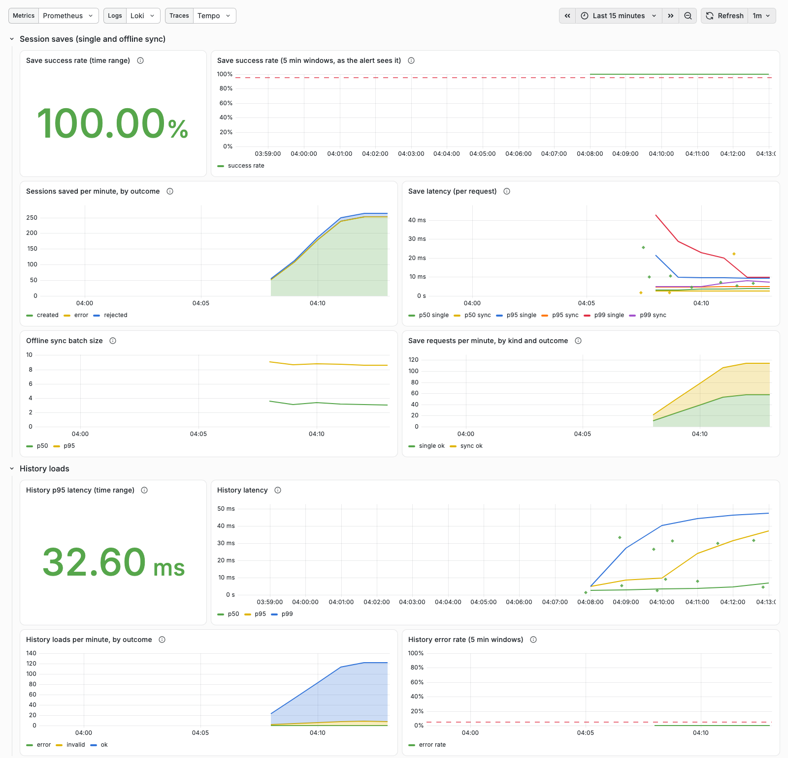
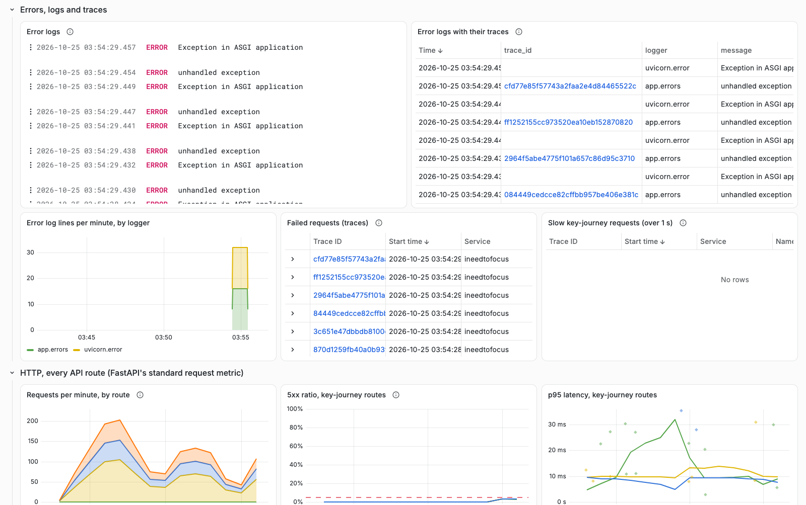
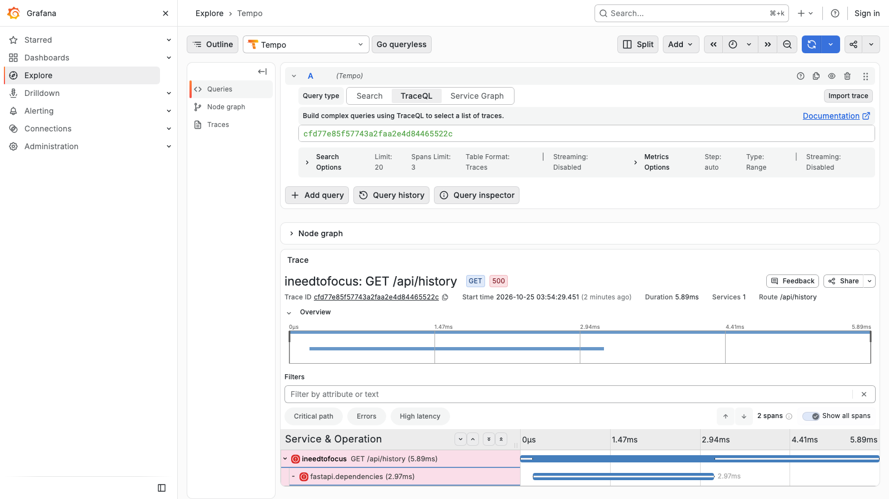

# Observability

Instrumented in #31; Grafana Cloud wiring and the key-journey dashboards in #32; the user-impact alert rules, the fault-injection trigger and the traffic script in #33; routing alerts to the on-call workflow in #34. The on-call agent itself follows in #35.

## Key user journey

Save a finished session (including offline sync batches) and load history.

## Signals

- **Traces:** every request is a FastAPI server span (`/healthz` is not traced), with a child span per SQL statement from the SQLAlchemy instrumentation (`app/telemetry.py`, `instrument_engine`; the stock instrumentor refuses SQLAlchemy 2.1, so the engine is wired directly). `db.statement` is the parameterised SQL (`$1`, `$2`), never bound values. The browser sends a W3C `traceparent` header on saves, sync batches, history loads and archive calls (`frontend/src/telemetry/tracedFetch.ts`), and the server continues that trace, so one trace ID covers click to database. The browser does not export spans, so the parent span ID in that header never arrives: Tempo shows the server span with a missing parent ("root span not yet received"). That is expected and harmless. Signed-in requests carry `enduser.id`, the opaque user UUID, on the server span.
- **Metrics** (`app/metrics.py`, OTLP, fixed low-cardinality labels):

  | Metric | Type | Labels |
  |---|---|---|
  | `focus.session.saves` | counter, per session | `kind` (single, sync); `outcome` (created, existing, rejected, error) |
  | `focus.session.save.duration` | histogram, seconds, per request | `kind`; `outcome` (ok, client_error, error) |
  | `focus.sync.batch.size` | histogram, sessions per sync request | none |
  | `focus.history.loads` | counter, per request | `outcome` (ok, invalid, error) |
  | `focus.history.load.duration` | histogram, seconds | `outcome` (ok, client_error, error) |

  The duration histograms use second-based buckets with an edge at 2 s (the history alert threshold); the SDK defaults are in milliseconds and would put every request in one bucket.

  What the outcomes cover: a failure inside the handler counts as `rejected` (the client's mistake: a conflict, an invalid session) or `error`. A failure before the handler, namely FastAPI's own 422 validation and an unexpected error such as the sign-in lookup failing during a database outage, is counted by the error handlers (`app/errors.py`): `rejected` or `invalid` for 422, `error` for the rest, once per request (a sync batch that fails that early counts as one). Requests answered 401 or 429 never reach a save or a load and are not counted. The duration histograms time the handler only (after authentication), and only for requests that reach it. The save error rate is `outcome="error"` over all `focus.session.saves`.
- **How the signals link:** logs, traces and metrics share the trace ID. In Grafana: a log line's `trace_id` links to the trace in Tempo; a trace shows its logs; the journey histograms carry exemplars (the OTel SDK attaches the trace ID of the sampled request to a measurement), so a latency panel point opens the trace behind it (enable exemplars on the panel). `make check-stack` proves all three links on a real save: the trace has the request and its SQL spans, Loki has the save's log line with that `trace_id`, and Prometheus has an exemplar with that `trace_id`.
- **Logs:** one JSON object per line on stdout, also shipped over OTLP. Every line has `trace_id` and `span_id` (32 and 16 hex characters; `null` outside a request, e.g. at startup), the same IDs as the spans, so Grafana jumps between a log line and its trace. Only the `extra=` fields in `ALLOWED_EXTRA` (`app/logging_config.py`) are kept; uvicorn's `color_message` (ANSI codes) never ships.

## Telemetry privacy (non-negotiable)

Never sent to logs, traces or metrics: email addresses, passwords, cookies or session tokens, session goals, YouTube links. Users appear only as an opaque internal ID. Enforced by allowlists and covered by tests (`tests/unit/test_telemetry.py`, `tests/unit/test_logging_fields.py`, `tests/integration/test_journey_telemetry.py`):

- **Span attributes:** only names in `ALLOWED_SPAN_ATTRIBUTES` leave the process (no user agent, client address, headers, cookies); exception events keep the type only and span status keeps the code but not the description (both can quote database rows or bound values). The allowlist runs first in the span-processor chain, before the exporter queues the span.
- **Paths and queries:** `url.query` is `REDACTED`. `url.path` and the path inside `url.full`, `http.url` and `http.target` are the route template (`/api/sessions/{session_id}`) for a matched request and `UNMATCHED` otherwise, so an email or an encoded YouTube link typed into a URL is never exported. The API contract therefore keeps emails, goals and YouTube links out of paths too.
- **Log fields:** the `extra=` allowlist above; message and exception text are scrubbed of Postgres `DETAIL` lines, SQL parameters, asyncpg's `invalid input for query argument $N: '<value>'` and ANSI codes. The save and sync handlers log one line each (`session saved`, `sessions synced`) so a trace has a log to link to.
- **Metric labels:** only the fixed words in the table; never a user, tag, goal or time zone.

## Alerts (user impact, not resources)

Two Grafana-managed alert rules per environment (#33), on the key journey only. None on CPU, memory or any other resource ([tech_stack.md §4](tech_stack.md)); `scripts/tests/test_grafana_alerts.py` fails if a rule queries anything but the journey metrics. The one recorded exception, a disk-usage alert outside Grafana that emails Yacine and doesn't wake the on-call agent, is the [Droplet disk alert](#droplet-disk-alert-digitalocean-202) (#202).

| Alert | Fires when | Queries (Prometheus, last 5 minutes) |
|---|---|---|
| **Session saves failing** | More than 5% of the sessions submitted failed, with at least 10 sessions submitted | A: `outcome="error"` over all `focus_session_saves_total`, the complement of the dashboards' save success rate, so a `rejected` session doesn't count. B: the sessions submitted, only when at least 10 (`… >= 10`). Condition: `$A > 0.05 && $B >= 10` |
| **History slow** | The p95 latency of `GET /api/history` is above 2 s, with at least 5 history loads | A: `histogram_quantile(0.95, …focus_history_load_duration_seconds_bucket…)`; 2 s is a bucket edge, so the estimate is exact at the threshold. B: the history loads that recorded a latency (`focus_history_load_duration_seconds_count`, the samples behind A, whatever their outcome), only when at least 5 (`… >= 5`). Condition: `$A > 2 && $B >= 5` |

- **Evaluation:** every minute; a rule fires once its condition has held for one more minute (pending period `1m`), and resolves on the first evaluation where it no longer holds. A sudden outage therefore fires about 2 minutes after it starts; the 5-minute window keeps a short blip from firing.
- **The minimum counts** stop one failed save or one slow history load at 3 a.m. from paging anyone. Below the minimum, query B returns nothing, so the window is "no data" and the rule stays Normal: it isn't a false condition, and it never fires. The save minimum is per session, not per request: a sync batch of 5 counts 5, as in the error rate. The history minimum (5 loads, the product manager's decision on #33) counts only the loads that recorded a latency, the samples A's p95 is computed from (#208). That's every load that reached the handler, whatever its outcome, including one the handler rejects (a time zone it doesn't know). A request FastAPI rejects with a 422 before the handler (a missing or malformed parameter) records no latency, so it doesn't count: otherwise 4 of them and 1 slow load would meet the minimum with a p95 of a single sample, and page. `focus_history_loads_total` still counts every request, for the dashboards' loads-by-outcome and error-rate panels.
- **Quiet periods are "no data", and no data is OK.** The journey counters exist from startup at 0 (below), so a 5-minute window without traffic is 0/0 (or a quantile of nothing), which is NaN, and Grafana takes a NaN condition as true. Each query therefore filters with `> 0`, which turns that into no data. A query that fails keeps the rule's last state (`execErrState: KeepLast`): a broken Grafana Cloud query isn't user impact, and it would otherwise raise an alert of its own.
- **Fresh outages count.** A counter series only exists from its first increment, and `increase()` needs two samples, so the first burst of errors after a start would be invisible: the error series would appear already at its burst value and the error rate would read 0. The app therefore adds 0 to every `kind` × `outcome` of `focus.session.saves` and every `outcome` of `focus.history.loads` at startup (`zero_journey_series` in `app/metrics.py`). The latency histograms aren't zero-initialised, so after a start the loads in the history histogram's first export (one metric export interval: 15 s locally, the SDK's 60 s deployed) count toward neither A nor B. Both queries see the same samples, so this can delay the history alert after a restart but never make it page.
- **Labels** `service=ineedtofocus`, `environment=<env>`, `alert=session-save-errors|history-latency`; the routing (#34) and the on-call agent (#35) go by them. **Annotations:** a summary, a description with the values (e.g. "19.67% of the 65 sessions submitted in the last 5 minutes failed"), the runbook (`_docs/runbooks/<alert>.md`) and the dashboard panel behind the alert.

The rules are generated, like the dashboards, from one model, `scripts/grafana_alerts.py`, which builds the queries with `scripts/grafana_dashboards.py`'s selectors so the two can't drift: `infra/grafana/alerts/key-journey-prod.json`, `-dev.json` and `-local.json`, in Grafana's alert provisioning format (what Grafana's own export writes). Each environment's group filters on its own `deployment_environment_name`. **Changing a rule:** edit the script, run `python3 scripts/grafana_alerts.py`, commit the JSON with it (`make test-scripts` fails when they differ), and after the merge re-apply it to Grafana Cloud ([below](#apply-the-alert-rules-to-grafana-cloud)).

**Locally**, `make up` provisions `key-journey-local.json` into grafana/otel-lgtm (**Alerting → Alert rules → I Need To Focus**). `make check-stack` (in CI too) checks that the rules are provisioned and evaluate without errors, that each of their queries runs, and that every metric selector in them returns series after its probe's save and history load (`python3 scripts/grafana_alerts.py verify`). So a renamed metric or label can't leave a rule quietly evaluating nothing. It checks the selectors, such as `focus_session_saves_total{…, outcome="error"}`, rather than the whole expressions, because those are "no data" by design when the window holds too little traffic: after one history load the latency series exists, but its p95 needs a second sample. The error-outcome series exists only thanks to the zero-initialisation, so this also checks that. Locally the rules have no contact point, so a firing alert shows in the UI only.

### Alert trigger: fault injection

`FAULT_SAVE_ERROR_PERCENT` (0 to 100, default **0, off**) makes that share of session save requests (`POST /api/sessions` and `POST /api/sessions/sync`) fail on purpose (`app/faults.py`). Only the operator can change it:

- It's an environment variable the app reads once at startup. No endpoint reads, shows or changes it (`tests/unit/test_faults.py` checks the routes and the OpenAPI schema), so no user can turn it on.
- Deployed, it comes only from the server's `/opt/focus/<env>/.env`. `infra/compose.prod.yml` defaults it to 0, `infra/env/<env>.env` never sets it (it would win over the server file), and `make test-infra` checks both.
- When it's on, the app logs a warning at startup: `fault injection on: session saves fail on purpose`, with `fault_save_error_percent`.

A request picked to fail raises `InjectedSaveFault` before anything is written, so it fails like a real server error: the client gets a 500 and keeps the session in its offline queue to retry later (nothing is lost), every session in the request counts as `outcome="error"`, and the log line (`unhandled exception`) and the trace carry the exception type `InjectedSaveFault`. That's how whoever is on call tells an injected fault from a real one. A rollback doesn't clear it, since the rolled-back app reads the same server file.

**Fire the save alert on dev** (the operator, on the server):

1. Add `FAULT_SAVE_ERROR_PERCENT=30` to `/opt/focus/dev/.env` and recreate the app: `APP_TAG=<current dev tag> infra/compose.sh dev up -d app`.
2. From any machine: `python3 scripts/traffic.py --base-url https://dev.ineedtofoc.us --minutes 10`.
3. **Session saves failing (dev)** goes pending, then fires, within about 3 minutes.
4. Delete the line (or set it to 0) and recreate the app the same way. The alert resolves within about 6 minutes, once the failures have left its 5-minute window.

### Traffic script

`scripts/traffic.py` sends realistic key-journey traffic. It signs up its own throwaway account (`traffic-<random>@example.com`, with a random password it never prints), then sends single saves (about 45%), offline sync batches of 2 to 5 sessions (15%; some repeat a session already saved, and now and then one holds an invalid session) and history loads over every view and a few time zones (40%). The default is 20 requests a minute for 10 minutes (`--rate`, `--minutes`; at most 120 a minute), enough to clear the save alert's minimum many times over without loading dev's small Droplet. It prints a line a minute, by result. Without fault injection almost nothing fails, so no alert fires. Each run leaves its throwaway account and the sessions it saved on the target (dev or your local stack); nothing cleans them up, and they are harmless there. It refuses to run against production (`ineedtofoc.us`): prod's alerts page the on-call agent, and its data is real users'. The check is by host name, which is enough because Caddy routes by host, so no other name or bare IP reaches prod. The default target is this checkout's local stack (`APP_PORT`).

### Proof on the local stack

On 2026-10-25, on a freshly started local stack (so the error series were new, the case the zero-initialisation is for): the app recreated with `FAULT_SAVE_ERROR_PERCENT=30` at 08:35:01Z, then `python3 scripts/traffic.py --rate 30 --minutes 9`, and at 08:38:30Z the app recreated with it back at 0 while the traffic went on. Times UTC:

```text
$ python3 scripts/grafana_alerts.py wait session-save-errors firing
08:35:31Z  session-save-errors: normal
08:36:51Z  session-save-errors: pending
08:37:51Z  session-save-errors: firing
$ python3 scripts/grafana_alerts.py wait session-save-errors normal
08:38:36Z  session-save-errors: firing
08:43:46Z  session-save-errors: normal
```

It fired 2 min 50 s after fault injection went on, and resolved 5 min 16 s after it went off. Grafana's description of the firing alert read "19.67% of the 64.96 sessions submitted in the last 5 minutes failed" (the count is a whole number now). The traffic script's total: 118 single saves ok and 15 failed, 37 sync batches ok and 2 failed, 110 history loads ok; **History slow** stayed normal throughout. `python3 scripts/grafana_alerts.py wait <rule> firing|pending|normal` waits for a local rule's state, for drills like this one.

**The history minimum**, the same day, with synthetic history metrics pushed over OTLP to the local stack (the app's resource labels, a separate instance). A single 3-second history load in an otherwise quiet window made A, the p95, 4.875 s, over the threshold. B, the loads, stayed "no data" (1 is below 5), and **History slow** stayed Normal for 4 minutes. With 7 slow loads in the window, B was 7, and the rule went pending and then fired a minute later.

**Rejected loads don't count (#208)**, the same day. At 17:39:31Z the local app received 4 history requests that FastAPI rejects with a 422 before the handler: a missing `tz`, a missing `view`, an unknown `view` and a malformed `date`. At 17:39:56Z a synthetic 3-second load was pushed as above. From 17:39:57Z to 17:44:27Z, A was 4.875 s. B, the loads that recorded a latency, was 1, so "no data". The old query over `focus_history_loads_total` read 5.06 and would have met the minimum. **History slow** stayed Normal throughout, and everything went back to no data once the loads left the 5-minute window.

### Apply the alert rules to Grafana Cloud

Grafana Cloud doesn't read the repo, and no agent has an editor login, so Yacine applies the rules once, and again after a PR changes them. `apply` creates or updates the environment's rule group through Grafana's alerting provisioning API, in the `I Need To Focus` folder (it creates the folder if it's missing). It keeps the rules editable in the UI, and it's idempotent, so a re-run overwrites with the repo's version.

1. In https://ineedtofocus.grafana.net, go to **Administration → Users and access → Service accounts → Add service account**. Name it `alert-rules-apply`, set the role to **Editor** and choose **Create**.
2. Choose **Add service account token**, name it `apply-<date>`, set **Expiration** to a day from now, choose **Generate token** and copy it.
3. From an up-to-date checkout of `main`, run `python3 scripts/grafana_alerts.py apply prod --grafana https://ineedtofocus.grafana.net` and paste the token at the prompt (it isn't echoed, stored or printed). Then run the same command with `dev`. `apply` refuses any `--grafana` URL that isn't `https://` (checked before it asks for the token), and never follows a redirect, which would carry the token elsewhere: use the stack's own URL.
4. Delete the token (or let it expire). The service account can stay for the next apply.
5. Check: **Alerting → Alert rules** lists **I Need To Focus → key-journey-prod** and **key-journey-dev**, two rules each, with state **Normal** and no error. Choose a rule's **View** to see its queries return a value.

If the stack's Prometheus data source isn't `grafanacloud-prom`, `apply` uses its one `grafanacloud-*-prom` data source, or asks for `--datasource <uid>` (shown in **Connections → Data sources**, in the data source's URL).

Once the routing is applied ([Alert routing](#alert-routing-34), below), a prod or dev alert, firing or resolved, wakes the on-call workflow. Until then, a firing alert follows the stack's default notification policy (**Alerting → Notification policies**), so it may notify no one; the rule's state in **Alert rules** is what to check.

## Alert routing (#34)

A firing or resolved alert in prod or dev wakes the on-call workflow:

```text
Grafana Cloud alert rule (#33; labels service, environment, alert)
  -> notification policy: service=ineedtofocus, environment=~prod|dev
  -> contact point focus-oncall-github (webhook, custom payload, Authorization: Bearer <token>)
  -> POST https://api.github.com/repos/ybenzine/ineedtofocus/dispatches
  -> repository_dispatch event, type grafana-alert
  -> .github/workflows/oncall.yml (#34: checks and logs the payload; #35: the on-call agent)
```

### Decision: Grafana calls GitHub directly, no relay

Grafana's webhook contact point (Grafana 12 and later, so Grafana Cloud and the local grafana/otel-lgtm 13) can do everything GitHub's dispatch endpoint needs:

- **Authorization header:** the `authorization_scheme` (`Bearer`) and `authorization_credentials` settings. The credentials are a secure field: Grafana stores them encrypted and reads them back as `[REDACTED]`.
- **Body:** a custom payload template (`payload.template`), a Go template rendered for each notification. Its `coll.Dict` and `data.ToJSON` functions build the JSON, so every value is escaped, an annotation's quotes and apostrophes included.
- **Headers:** `Accept: application/vnd.github+json` and `X-GitHub-Api-Version` as extra headers. Grafana adds `Content-Type: application/json` and `User-Agent: Grafana`, which GitHub requires.

So nothing of ours sits between Grafana and GitHub: no relay to host, secure, monitor or keep up while prod is down. A relay wouldn't make the GitHub token any less powerful either. It would need the same kind of token, kept in a server `.env` file instead of Grafana Cloud, and would add a public endpoint of its own. Checked on the local Grafana 13.2: the payload template, the stored token and the extra headers, both with a real alert and through the contact point test ([below](#proof-on-the-local-stack-34)).

### The token

The token is a **fine-grained personal access token** of `ybenzine`, limited to this repository. It has **Contents: Read and write** and nothing else; GitHub adds Metadata read-only by itself. It lives **only** in the Grafana Cloud contact point. It's never in git, in GitHub secrets or variables, or in a server `.env` file. Yacine creates it and enters it at `apply`'s hidden prompt ([below](#set-up-in-grafana-cloud-yacine)). It expires after 90 days; to rotate it, create a new one and run `apply cloud` again.

- **Why Contents write:** it's the only permission GitHub's `POST /repos/{owner}/{repo}/dispatches` accepts. Actions write would only allow a `workflow_dispatch`, and it would also let the token start, cancel and re-run any workflow, `rollback` included. A GitHub App token would have the same Contents permission and expire after an hour, and Grafana can't renew it.
- **Why it can't approve or start a deploy, though it's Yacine's:** a fine-grained token can do only what its permissions allow, whoever owns it. This one has no **Deployments**, **Actions**, **Administration**, **Environments** or **Workflows** permission. So it can't approve a pending deployment (Deployments write), start `deploy-prod` or `rollback` (Actions write), edit an environment or its reviewers (Administration), or change a workflow file (Workflows). The separation from #127 holds: no credential an agent can reach approves a deploy, and this one is never available to agents. A dispatch only starts `oncall.yml`; `scripts/tests/test_ci_workflow.py` checks that `deploy-prod` starts only by hand.
- **What a leaked token could do:** push to branches other than `main`, and delete or move unprotected branches and tags. It could create releases, and send dispatches, which wake on-call (#35's agent) with a payload that still has to pass the check below. It could **merge a pull request that is already approved and green**, because GitHub's merge endpoint needs only Contents write. It can't open a pull request, and a branch push starts no CI (CI runs on pull requests and on pushes to `main`). It **can't** change `main` any other way: branch protection requires the CI checks and an approval of the latest push, for administrators too ([process.md](process.md#4-review)). To stop it, revoke the token in GitHub (**Settings → Developer settings → Fine-grained tokens**).
- **Runs show `ybenzine`:** a dispatch made with the token shows `ybenzine` as the run's actor and as the event's `sender` (in the job summary), not Grafana. A run named after an alert that has no matching Grafana alert (**Alerting → Alert rules**, state history) means someone else used the token.
- **Grafana Editors can get it:** anyone who can edit contact points in Grafana Cloud (Editor or Admin) can point `focus-oncall-github` at their own URL, and Grafana will send them the stored token. Keep Editor and Admin in the stack to Yacine. Service account tokens for `apply` are Editor and expire within a day (step B on #34). #35's `GRAFANA_READONLY_TOKEN` must stay **Viewer**: a Viewer can't change contact points, and reads the stored token back only as `[REDACTED]`.
- **Authenticated only:** GitHub accepts a dispatch only with a token that can write to the repo. Grafana's token is one. The other is the agent account's, and `.claude/settings.json` denies `gh api …dispatches…` to agents. So an unauthenticated caller can't start the workflow, and there's no public endpoint of ours to attack. The `oncall` workflow still treats the payload as untrusted. It reads it from `$GITHUB_EVENT_PATH`, never through `${{ }}` in a script, checks it against the contract below and fails red otherwise. The job summary names the sender.

### The notification policy and contact point

`scripts/alert_routing.py` generates both, like the dashboards and the alert rules. The committed `infra/grafana/routing/oncall-github.json` is what `apply cloud` sends, minus the token. `make test-scripts` fails when that file and the script disagree.

| Setting | Value | Why |
|---|---|---|
| Matchers | `service=ineedtofocus`, `environment=~prod\|dev` | The labels #33's rules carry. A local rule never reaches Grafana Cloud anyway |
| Group by | `alertname`, `alert`, `environment` | One notification is one alert in one environment, so one dispatch is one incident |
| Group wait / interval | 10 s / 1 min | The rule's 1-minute pending period already debounces. A resolved notification follows within a minute |
| Repeat interval | 4 h | A still-firing alert is sent again every 4 hours. #35 updates the open incident rather than opening another |
| Resolved messages | sent | #35 confirms that the alert resolves |
| Position | first child of the root policy, `continue: false` | `apply` replaces only its own route and leaves every other policy as it was |

### The payload (contract for #35)

Event type **`grafana-alert`**; `client_payload` (`scripts/alert_dispatch.py` is the reference and the check):

| Field | Example | From |
|---|---|---|
| `alert` | `session-save-errors` or `history-latency` | the rule's `alert` label; the runbook is `_docs/runbooks/<alert>.md` |
| `environment` | `prod` or `dev` | the rule's `environment` label |
| `status` | `firing` or `resolved` | Grafana |
| `title` | `Session saves failing (prod)` | the rule's title (`alertname`) |
| `summary`, `description` | `Over 5% of session saves are failing in prod`; `19.67% of the 65 sessions submitted …` | the rule's annotations (aggregates only) |
| `started_at` | `2026-10-25T08:37:51Z` | when the alert started firing, UTC |
| `resolved_at` | empty while firing, then `2026-10-25T08:43:46Z` | UTC |
| `links.dashboard` | `https://ineedtofocus.grafana.net/d/focus-key-journey-prod?orgId=1&from=…&to=…` | the environment's key-journey dashboard, from 30 minutes before the alert to now (or to 10 minutes after it resolved) |
| `links.traces` | `https://ineedtofocus.grafana.net/explore?…` | Tempo, same time range: failed save requests (`status=error` on the save routes) or history loads over 1 s |
| `links.runbook` | `https://github.com/ybenzine/ineedtofocus/blob/main/_docs/runbooks/session-save-errors.md` | `_docs/runbooks/<alert>.md` once that file is on `main`. Until then (#35 writes both runbooks) it's the runbooks index, `_docs/runbooks/README.md`, so the link never points at a missing file. The rules' `runbook_url` annotation (#33) names the runbook ahead of time, so the template doesn't copy it |
| `links.alert` | `https://ineedtofocus.grafana.net/alerting/grafana/focus-session-save-errors-prod/view?orgId=1` | the rule in Grafana; a contact point test, which has no rule, links the alert list instead |

**No customer data:** the template copies only these named labels and annotations, never all of them, and the rules' labels and annotations hold only fixed words and aggregate numbers. The check refuses a missing or unexpected field, an environment other than prod or dev, a link outside `https://ineedtofocus.grafana.net/` or this repo's runbooks, and any text holding an email address or a YouTube link. GitHub allows at most 10 top-level `client_payload` fields; this has 9.

**Free text an agent reads:** #35 hands the payload to an agent, so whoever sends a dispatch must not be able to write instructions into it. Every text field (`title`, `summary` and `description`) is pinned to #33's rules for that alert and environment. `alert_dispatch.py` reads them from `grafana_alerts.rules()` rather than keeping a copy, so a rule edit moves the check with it (#212).

- `title` and `summary` must be exactly the rule's title and summary. Both are fixed text.
- `description` must match a pattern built from the rule's description template. The literal prose must be exact, and each `{{ … }}` slot may hold only what its function renders: a percentage (`humanizePercentage`, e.g. `30.95%`), a whole number (`printf "%.0f"`, e.g. `87`) or a duration (`humanizeDuration`, e.g. `4.875s` or `2m 3s`). A slot with any other function fails the tests until `SLOT_VALUES` gives it a pattern, so a new kind of slot can't let free text through.
- The slot patterns are exactly the shapes Prometheus' template functions print, which Grafana uses. They accept ASCII digits only, so `٣٠%` or `３０%` fails. A percentage has Go's `%.4g` shape (at most 4 significant digits), and a whole number has 1 to 15 digits, so a slot can't spell out text in digits. A duration is only one of `humanizeDuration`'s forms: `1d 2h 3m 4s`, `2h 0m 5s` or `3m 4s` with hours under 24 and minutes and seconds under 60, `4.875s`, `0s`, or a sub-second form such as `500ms`. Tests check every value the functions can print against the patterns, over values from 1e-24 to 1e8.
- **The check fails closed.** If an allowed alert and environment has no rule in `grafana_alerts.py`, the dispatch is refused with "no rule for …" rather than passed unchecked. If Grafana ever renders a slot in a form the pattern rejects (a future Grafana changing `humanizeDuration`, say), the dispatch fails `check-event` and the `oncall` run goes red. Nothing reaches the agent, and the alert is still in Grafana. #35's runbook should say so: on a red `oncall` run whose error is "description is not the rule's template", compare the rendered value with `SLOT_VALUES` and widen the pattern to the new form only.
- On top of that, none of the three may hold a link (`http://`, `https://`, `www.` or a Markdown link); links go only in `links`, which is checked.

The synthetic alerts that `verify` renders and `test` sends carry the rule's description with `0` in every slot (`0% of the 0 sessions submitted …`), so they pass the same check and say nothing failed. A contact point test is told apart by `links.alert`, which links the alert list rather than a rule. `scripts/tests/test_alert_dispatch.py` checks that every real dispatch passes (both alerts, prod and dev, firing and resolved) and that injection attempts fail `check-event` (`test_a_description_other_than_the_rules_fails_check_event`, `test_a_prompt_injection_fails_check_event`). Pinning limits what a sender can say, not whether the numbers are true: #35's prompt still presents every payload field as untrusted data and reads the real values from Grafana.

**For #35:** keep `python3 scripts/alert_dispatch.py check-event "$GITHUB_EVENT_PATH"` as the workflow's first step and add the agent job after it. That job needs `needs:` on the check and the `oncall` environment. A `repository_dispatch` always runs on the default branch, `main`, which the environment's branch rule allows. Pass the payload to the agent as the event file or through `env:`, never with `${{ }}` inside a `run:` script. A concurrency group per `alert` and `environment`, never cancelling, makes a resolved event wait for its firing run. Repeats and resolutions come as new runs, so look up the open `type:incident` issue for the same alert and environment first. Adding `_docs/runbooks/<alert>.md` makes `infra/grafana/routing/oncall-github.json` stale: `make test-scripts` fails until you run `python3 scripts/alert_routing.py`. After the merge, `apply cloud` has to run again, a human step, so that the dispatches link the runbooks. Until then they keep linking the index, which the check still accepts. `scripts/tests/test_alert_routing.py` asserts that the stub has one job, no environment and no secrets (`test_the_workflow_holds_no_credential`, `test_the_workflow_checks_the_payload_without_injection`). #35 is meant to change those assertions when it adds the agent job in `oncall`. Keep their intent: the check job stays secret-free, and payload values never appear in `${{ }}` inside `run:`.

### Proof on the local stack (#34)

`make check-stack` (in CI too) has the local Grafana render the payload template for both alerts, prod and dev, firing, resolved and a contact point test. Every result must pass the workflow's check (`python3 scripts/alert_routing.py verify`).

**The full loop locally**, with a stand-in for GitHub's endpoint. It requires the bearer token, validates every dispatch the way the workflow does and answers 204, or 401, 404 or 422 like GitHub. It needs Docker Desktop, whose `host.docker.internal` lets the Grafana container reach the host, and #33's rules and fault injection:

1. `python3 scripts/alert_dispatch.py receive --out /tmp/dispatches.jsonl`. It prints a throwaway stand-in token.
2. `python3 scripts/alert_routing.py apply local --grafana http://127.0.0.1:<GRAFANA_PORT>`, and paste the stand-in token. This adds the same contact point to the local Grafana, posting to the stand-in, with a route for `environment=local`. Blank keeps the stored token on later runs.
3. `python3 scripts/alert_routing.py test local --env local --alert history-latency --grafana http://127.0.0.1:<GRAFANA_PORT>` sends a contact point test. The stand-in prints `204   history-latency firing in local`.
4. Fire and resolve **Session saves failing** with fault injection and `scripts/traffic.py` ([#33](#alerts-user-impact-not-resources)). The stand-in prints one line per dispatch.

On 2026-10-25, on the local stack with #33's rules, `FAULT_SAVE_ERROR_PERCENT=30` from 17:07:50Z and off again at 17:11:11Z, with `traffic.py --rate 30` running:

```text
17:09:21Z  session-save-errors: pending
17:10:21Z  session-save-errors: firing
204   session-save-errors firing in local (started 2026-10-25T17:10:10Z, resolved -)
17:15:22Z  session-save-errors: normal
204   session-save-errors resolved in local (started 2026-10-25T17:10:10Z, resolved 2026-10-25T17:15:10Z)
```

Both dispatches arrived with `Authorization: Bearer <stand-in token>`, `Accept: application/vnd.github+json`, `Content-Type: application/json` and `User-Agent: Grafana`. Both passed the check, with the description `30.95% of the 87 sessions submitted in the last 5 minutes failed (outcome="error"); … Users' sessions stay queued …`. The traces link's query found the 19 failed save requests in Tempo. A request without the token gets 401 (covered by `scripts/tests/test_alert_dispatch.py`).

**A resolution with no data (#212)**, the same day. Fault injection stayed on and the traffic stopped at 18:26:51Z, so the rule could resolve only through "no data". It fired at 18:24:20Z with `20.47% of the 99 sessions submitted …`. It resolved at 18:32:20Z as **Normal (NoData)**, and the resolved dispatch carried the description of the last evaluation that had data, `30% of the 21 sessions submitted …`. Both dispatches pass the pinned check, so a no-data resolution has the same shape as any other.

### Set up in Grafana Cloud (Yacine)

Do this once, after the PR that adds `.github/workflows/oncall.yml` is merged: a dispatch only starts workflows that are on `main`. The exact steps are on [#34](https://github.com/ybenzine/ineedtofocus/issues/34):

1. Create the fine-grained token ([above](#the-token)). Then check that its page lists only **Contents: Read and write** and **Metadata: Read-only**. With any other permission, the analysis above no longer holds.
2. Create a Grafana service account token (Editor, one day), as for the alert rules.
3. `python3 scripts/alert_routing.py apply cloud --grafana https://ineedtofocus.grafana.net`, pasting the Grafana token and then the GitHub token at the hidden prompts. A re-run updates both in place. A blank GitHub token keeps the stored one, which `apply` only ever sends back as `[REDACTED]`.
4. `python3 scripts/alert_routing.py test cloud --env dev --alert session-save-errors --grafana https://ineedtofocus.grafana.net`, then check that **Actions → oncall** shows a green run named **Alert: session-save-errors firing in dev**.

The contact point and policy stay editable in the Grafana UI, but the next `apply` overwrites them, so make changes in the script.

### Droplet disk alert (DigitalOcean, #202)

One alert watches a resource: the Droplet's disk. It's a DigitalOcean Monitoring alert policy, configured by Yacine in the DigitalOcean console (**Monitoring**, under its resource alert policies), not in this repo:

| Policy | Metric | Fires when | Resource | Notifies |
|---|---|---|---|---|
| `ineedtofocus disk > 80%` | `do.droplets.disk_utilization` (Disk Utilization) | Above 80% for 10 minutes (critical) | The Droplet, `flocus-s-1vcpu-2gb-nyc1` | Yacine, by email |

**Why this one exception to user-impact-only alerting.** Prod and dev share one disk, and a full disk breaks both at once: Postgres stops accepting writes, and a `releases.log` line cut short stops every deploy and rollback that reads it ([deployment.md → The release record](deployment.md#the-release-record)). The session-save alert would fire only once the disk is already full, so it gives no lead time. At 80% there's time to clean up before any user notices. The policy is free and needs nothing on the server but the DigitalOcean metrics agent. Without the agent, the Droplet's **Insights** tab still shows CPU and bandwidth; the agent adds the disk and memory graphs, and the disk metric this policy reads. `bootstrap.sh` doesn't install that agent, so after a rebuild check that the disk graph shows data again; without it, the policy has nothing to evaluate. CPU and memory stay unalerted: memory is bounded per container, and the user-impact alerts already catch what they would cause.

**Not connected to anything else.** It notifies by email only: no Slack, no webhook, no Grafana contact point, and it never reaches the on-call agent (#35). A rollback can't free disk, and the fix needs a person on the server. Nothing in Grafana watches the disk either: no Grafana rule, and no `hostmetrics` receiver in the collectors, which stay per-environment and read only their app's telemetry ([#117](deployment.md#host-resources-processes-privileges-disk-117)'s isolation). `scripts/tests/test_grafana_alerts.py` still fails if a Grafana rule queries anything but the journey metrics.

**When it fires** (Yacine, on the server):

1. **How full, and where.** `df -h /` shows the root filesystem's use; it's the one disk, holding Docker's data (`/var/lib/docker`) too. `docker system df -v` splits Docker's share into images, containers, local volumes and build cache, with each volume's size. For what's outside Docker: `sudo du -xh --max-depth=2 / 2>/dev/null | sort -h | tail -20`.
2. **What usually fills it**, in the order to check it:
   - **The Postgres volumes**, `focus-prod_db-data` and `focus-dev_db-data` (their sizes are in `docker system df -v`). They're the one thing that grows by design. Dev's grows with every `scripts/traffic.py` run, whose throwaway accounts and sessions nothing cleans up ([Traffic script](#traffic-script)). Prod's data is real users': never delete it to free space. If prod's volume itself is what's large, resizing the Droplet or adding a volume is a cost decision for Yacine.
   - **Old images.** Every deploy and rollback prunes the app images neither environment may start again ([deployment.md → Old images: pruning (#117)](deployment.md#old-images-pruning-117)). If `docker image ls ghcr.io/ybenzine/ineedtofocus` lists many more than both environments' windows, pruning is skipping: look for `not pruning old images` in `journalctl -t focus-ci`, and check that the installed `focus-ci` is current (`install.sh`). Never run `docker image prune -a` or `docker system prune -a`: they remove the pinned dependency images, and a rollback would then depend on Docker Hub. Images are built in CI, never on the server, so the build cache should be empty.
   - **Container logs.** Docker rotates each container's log at 3 × 10 MB (`/etc/docker/daemon.json`, set by `bootstrap.sh`), so these stay small unless that file was changed or a container predates it. Check `sudo du -sh /var/lib/docker/containers`. The system journal grows too: `journalctl --disk-usage`, and `sudo journalctl --vacuum-size=200M` trims it. Trimming deletes the oldest entries of every unit, `focus-ci`'s deploy, rollback and pruning history included, so read `journalctl -t focus-ci` (the old-images check above) before you trim, and trim only if the journal is what's large.
   - **apt caches and old kernels**, from unattended upgrades: `sudo du -sh /var/cache/apt`, then `sudo apt-get clean` and `sudo apt-get autoremove`.
   - **A manual mistake**: a dump, a copied image or a log left in a home directory or `/tmp`. The `du` above finds it.
3. **Resolved** once use is back below 80%. If the disk filled before anyone acted, a `releases.log` line may have been cut short: deployment.md's [release record](deployment.md#the-release-record) says how to find and move it out.

## Where to look

| Where | Grafana | Dashboard |
|---|---|---|
| Local (`make up`) | `grafana/otel-lgtm` at `http://localhost:<GRAFANA_PORT>` (3000 by default) | **I Need To Focus → I Need To Focus: key journey (local)**, provisioned by `compose.yaml` |
| Dev, prod | Grafana Cloud stack https://ineedtofocus.grafana.net | **I Need To Focus: key journey (dev)** / **(prod)**, imported from `infra/grafana/dashboards/` ([below](#dashboards-32)) |

## Grafana Cloud (#32)

| | |
|---|---|
| Stack | https://ineedtofocus.grafana.net |
| OTLP endpoint | `https://otlp-gateway-prod-us-east-3.grafana.net/otlp` |
| Instance ID (OTLP basic-auth user) | `1889715` |

### One collector per environment

Each Compose project (`focus-prod`, `focus-dev`) keeps its own OpenTelemetry Collector (`infra/otel-collector/`, [deployment.md](deployment.md#telemetry-to-grafana-cloud)). #32 settles this; a single shared collector was the alternative. Reasons:

- **Dev can't hurt prod's telemetry.** A burst from dev fills dev's batch queue and trips dev's `memory_limiter`, never prod's. Each collector has its own 96 MiB limit, and dev's has `oom_score_adj: 500` like the rest of dev ([deployment.md](deployment.md#memory-dev-cant-starve-prod)).
- **The environment label can't be wrong.** Each collector upserts `deployment.environment.name` from its own `FOCUS_ENV` (`prod` or `dev`) onto every span, metric and log record. A shared collector would have to trust what each app sends.
- **Separate credentials.** Each environment's token lives in its own `/opt/focus/<env>/.env`. The two files may hold the same token or one each; with one each, dev's can be revoked without touching prod.
- **Cost:** 96 MiB of the Droplet's memory budget, already counted ([deployment.md](deployment.md#memory-dev-cant-starve-prod)).

Dev and prod are told apart in Grafana Cloud by `deployment.environment.name`, the current OpenTelemetry name for `deployment.environment`. Grafana Cloud promotes it to a label:

- metrics: `deployment_environment_name="prod"`;
- logs: `| deployment_environment_name="prod"`, which works whether Loki indexes it or keeps it as structured metadata;
- traces: `resource.deployment.environment.name="prod"`.

The local stack sets `local` (`compose.yaml`).

### Credentials

| Token | Scopes | Lives only in | Read by |
|---|---|---|---|
| OTLP write token (`GRAFANA_CLOUD_OTLP_TOKEN`) | `metrics:write`, `logs:write`, `traces:write` | `/opt/focus/prod/.env` and `/opt/focus/dev/.env` on the server (mode 600), next to `GRAFANA_CLOUD_OTLP_ENDPOINT` and `GRAFANA_CLOUD_INSTANCE_ID` ([.env.example](../.env.example), "Deployed environments") | That environment's collector |
| Read-only token (`GRAFANA_READONLY_TOKEN`) | read metrics, logs, traces | The GitHub `oncall` environment's secrets | The on-call workflow (#35) |
| GitHub dispatch token (#34), the other way round: Grafana → GitHub | fine-grained, this repo only, Contents write | The Grafana Cloud contact point `focus-oncall-github` (encrypted, read back as `[REDACTED]`) | Grafana's webhook ([Alert routing](#the-token)) |

None of these tokens is ever in git, in repo-level GitHub secrets or in any other environment; the dispatch token isn't in any GitHub environment either. `scripts/tests/test_grafana_dashboards.py` fails if a workflow mentions the OTLP token, or reads the read-only token outside a job in the `oncall` environment. To rotate the OTLP token, put the new value in both `.env` files and recreate each collector: `APP_TAG=<current tag> infra/compose.sh <env> up -d otel-collector`.

### Check that both environments arrive

In Grafana Cloud, open **Explore** and run:

| Data source | Query | Expect |
|---|---|---|
| `grafanacloud-…-prom` | `count by (deployment_environment_name) (http_server_request_duration_seconds_count{service_name="ineedtofocus"})` | A `dev` and a `prod` series (an environment shows once its app has served requests and sent metrics, within a minute) |
| `grafanacloud-…-logs` | `{service_name="ineedtofocus"} \| deployment_environment_name="prod"` | Prod's log lines |
| `grafanacloud-…-traces` | `{resource.service.name="ineedtofocus" && resource.deployment.environment.name="prod"}` | Prod's request traces |

The metrics query counts a request metric's data points, not `target_info`: `target_info` carries the resource attributes even when Grafana Cloud doesn't promote `deployment.environment.name` onto every series, and then every dashboard panel and alert query, which filter on the data points' `deployment_environment_name`, would be empty while that check passed ([#32](https://github.com/ybenzine/ineedtofocus/issues/32#issuecomment-6395384377)).

Then open the dev dashboard (**I Need To Focus: key journey (dev)**) and confirm the panels show data: the **Session saves**, **History loads** and **HTTP, every API route** rows should show lines and numbers, not "No data" (use dev once first if it has had no traffic lately).

If an environment is missing, look at its collector's logs on the server: `APP_TAG=<current tag> infra/compose.sh <env> logs otel-collector`. A 401 there means a wrong instance ID or token.

## Dashboards (#32)

One key-journey dashboard per environment: `infra/grafana/dashboards/key-journey-prod.json`, `-dev.json` and `-local.json`. The three are generated from one model, `scripts/grafana_dashboards.py`, and differ only in the environment they filter on and their default data sources. Each has a fixed UID (`focus-key-journey-<env>`) and links to the others.

| Row | Panels | Source |
|---|---|---|
| Session saves | Save success rate over the time range and over 5-minute windows (with the 95% alert line); sessions saved per minute by `outcome`; save latency p50/p95/p99 by `kind`, with exemplars that open their trace; offline sync batch size; save requests by `kind` and `outcome` | `focus_session_saves_total`, `focus_session_save_duration_seconds`, `focus_sync_batch_size` |
| History loads | p95 latency over the time range; p50/p95/p99 latency with the 2 s alert line and exemplars; loads per minute by `outcome`; error rate | `focus_history_load_duration_seconds`, `focus_history_loads_total` |
| Errors, logs and traces | Error logs (severity ERROR and above); the same lines as a table whose `trace_id` opens the trace in Explore; error log lines per minute by logger; failed requests (TraceQL, `status=error`); key-journey requests over 1 s | Loki, Tempo |
| HTTP, every API route | Requests per minute by route; 5xx ratio and p95 latency of the key-journey routes | `http_server_request_duration_seconds` (FastAPI's standard metric) |

**Metric names.** The dashboards query the Prometheus form of the OpenTelemetry metrics in [Signals](#signals). Dots become underscores, a unit of `s` adds `_seconds`, a counter adds `_total`, and annotation units such as `{session}` add nothing:

| OpenTelemetry (backend, #31) | Prometheus (dashboards) |
|---|---|
| `focus.session.saves` | `focus_session_saves_total` |
| `focus.session.save.duration` | `focus_session_save_duration_seconds_bucket` / `_count` / `_sum` |
| `focus.sync.batch.size` | `focus_sync_batch_size_bucket` / `_count` / `_sum` |
| `focus.history.loads` | `focus_history_loads_total` |
| `focus.history.load.duration` | `focus_history_load_duration_seconds_bucket` / `_count` / `_sum` |
| `http.server.request.duration` (FastAPI) | `http_server_request_duration_seconds_bucket` / `_count` / `_sum` |

**Save success rate** is `1 - outcome="error" / all sessions submitted`, the complement of the alert's save error rate: a `rejected` session (invalid input, an id conflict) was handled correctly, so it doesn't count against it. While nothing has failed, the rate reads 100%, not "no data".

### Import into Grafana Cloud (prod and dev)

Do this once, and again after a PR changes a dashboard. Grafana Cloud doesn't read the repo, and an import needs an editor's login, which no agent has.

1. In https://ineedtofocus.grafana.net, open **Dashboards**. Choose **New → New folder**, name it `I Need To Focus` and create it. Skip this step once the folder exists.
2. Choose **New → Import**. Under **Upload dashboard JSON file**, choose `infra/grafana/dashboards/key-journey-prod.json` from a checkout of `main` (or paste the file's raw GitHub contents).
3. Set **Folder** to `I Need To Focus` and leave the name and UID as they are. Choose **Import**. When re-importing, Grafana says a dashboard with that UID exists; choose **Import (Overwrite)**.
4. Repeat with `key-journey-dev.json`.
5. Open each dashboard. If a panel says the data source wasn't found, pick the stack's data sources in the **Metrics**, **Logs** and **Traces** dropdowns at the top: `grafanacloud-ineedtofocus-prom`, `-logs` and `-traces`. The defaults are Grafana Cloud's built-in UIDs (`grafanacloud-prom`, `grafanacloud-logs`, `grafanacloud-traces`), which normally match. Then **Save dashboard**.

**Changing a dashboard:** edit `scripts/grafana_dashboards.py`, run `python3 scripts/grafana_dashboards.py` and commit the regenerated JSON with it. `make test-scripts` fails when the JSON and the script disagree. After the merge, re-import. Changes made in the Grafana UI are overwritten by the next import, so move them into the script.

**Locally**, `make up` provisions `key-journey-local.json` into grafana/otel-lgtm (read-only in the UI). After regenerating it, recreate the container with `docker compose up -d lgtm`. This drops the local telemetry, which lgtm keeps in memory. `make check-stack` (in CI too) checks that the dashboard is provisioned and that each of its queries runs against Prometheus, Loki and Tempo (`python3 scripts/grafana_dashboards.py verify`). Since #33 every Prometheus query must also return data, after the probe's save and history load: an unknown metric or label parses fine and returns nothing, which would otherwise blank a panel silently. The Loki and Tempo queries only have to run, since the error panels are rightly empty while nothing fails.

### Screenshots

These come from the local stack, which uses the same model as prod and dev. They show the last 15 minutes of saves, sync batches (some with an invalid item) and history loads (some with a bad time zone), including a few seconds with Postgres stopped. Retake them with `node scripts/grafana_screenshots.mjs`.





Clicking a `trace_id` in **Error logs with their traces** opens the failed request's trace in Explore:


